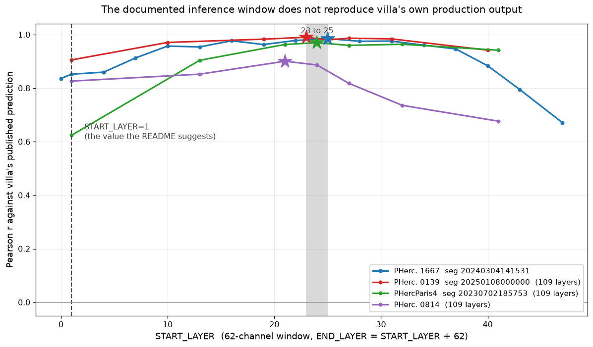
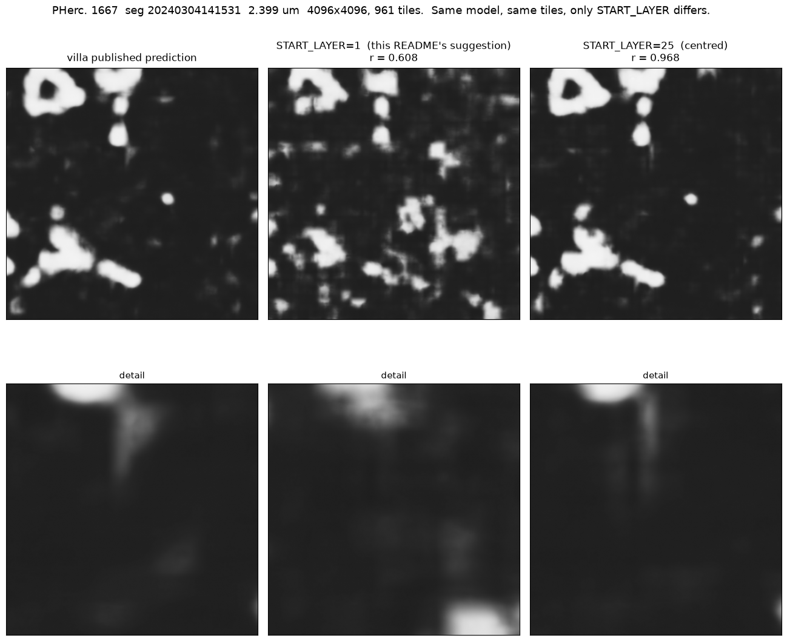
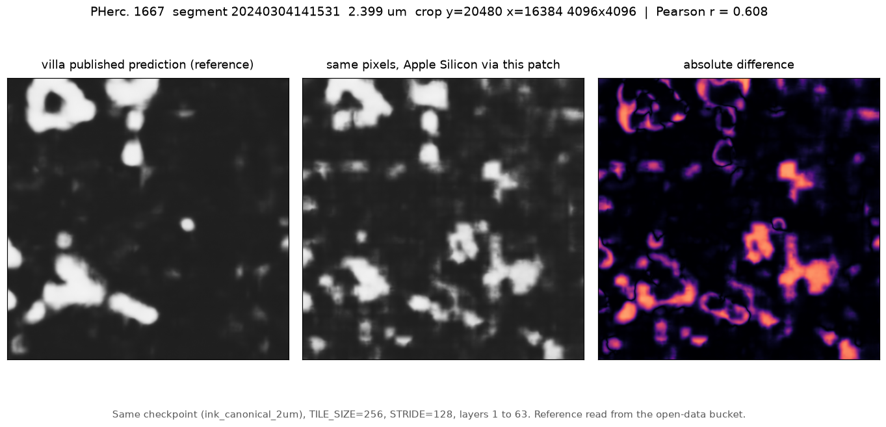
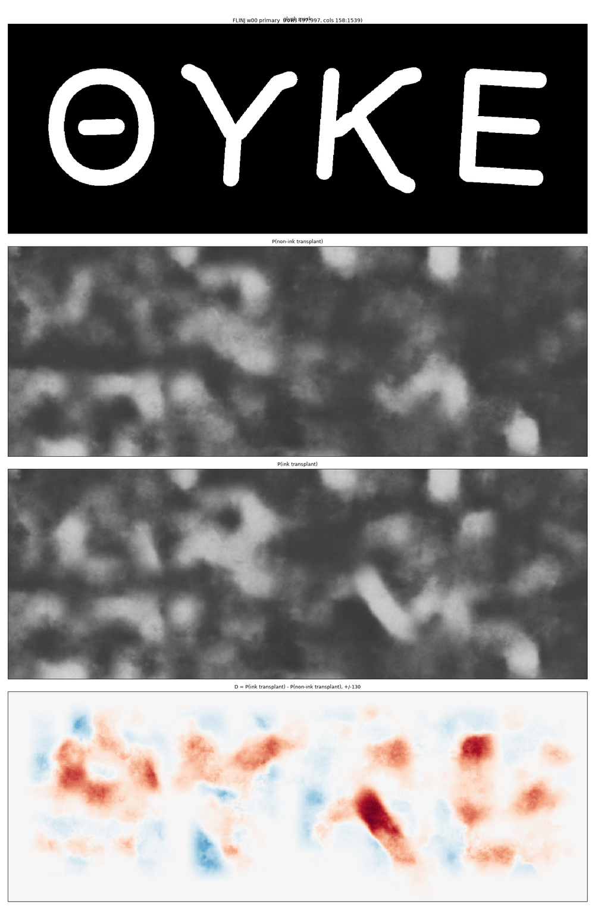
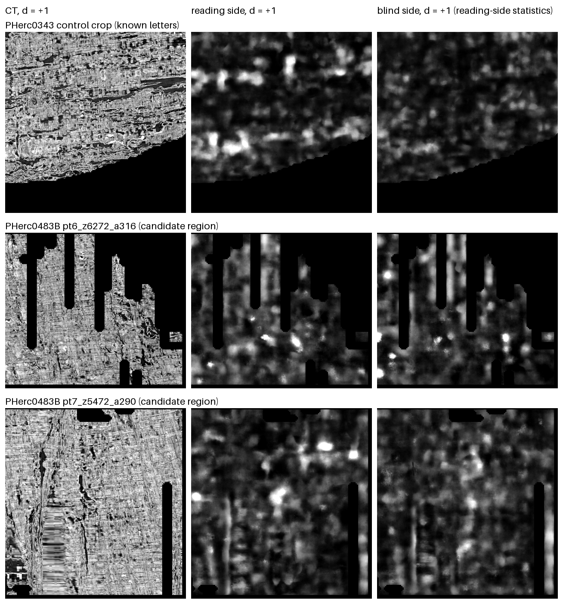

# Apple Silicon support for villa's ink detection inference

`villa/ink-detection/optimized_inference` selects its device with

```python
device = torch.device("cuda" if torch.cuda.is_available() else "cpu")
```

There is no MPS branch, so every Apple Silicon Mac silently takes the CPU path.
Downstream of that, the autocast device type is chosen as

```python
amp_device = "cuda" if device.type == "cuda" else "cpu"
```

which, when the tensors are on MPS, makes autocast a no-op rather than an
error.

This repository holds a small patch that adds the MPS path, plus the
measurements behind it and a local runner that needs no container and no AWS
credentials. Everything is measured on real scroll data: PHerc. 1667, segment
`20240304141531-w013_20240304141531_flatboi`, the 2.399 um surface volume, with
`scrollprize/ink_canonical_2um` (`r152_3ddec_v2_l5_epoch13.ckpt`).

## What it buys

Same checkpoint, same tiles, `TILE_SIZE=256`, `STRIDE=128`, layers 1 to 63,
loaded through villa's own `model_resnet3d_3d_decoder.load_model`.

Nine timed repetitions per MPS configuration and three for CPU, after an
untimed warmup, reported as min / median / max per villa's `AGENTS.md` rule
1.4 rather than as a bare mean.

| path | min | **median** | max | forward memory |
|---|---|---|---|---|
| CPU, fp32, what a Mac gets today | 3.259 | **3.261** | 3.278 | **9.53 GB** |
| MPS, autocast off | 0.524 | 0.525 | 0.526 | 2.59 GB |
| MPS, villa's current `amp_device` | 0.525 | 0.526 | 0.527 | 2.59 GB |
| MPS, `amp_device` corrected | 0.426 | **0.427** | 0.428 | 7.85 GB at batch 4 |

Seconds per tile. **7.63x faster.** Note rows two and three: villa's current
autocast line times identically to autocast being switched off, which is the
same no-op shown numerically below. The memory number matters more than the speed one. The CPU
path costs about **9.9 GB per tile** (9.53 GB at batch 1, 19.89 GB at batch 2),
so on a 16 GB Mac one tile barely fits and two do not. MPS at batch 4 needs
7.85 GB. For most Macs this is the difference between running the inference and
not running it.

Each configuration was measured in a **fresh process**, because `ru_maxrss` is
a process-wide high-water mark and a single-process sweep reports the maximum
of everything that ran before it.

**The two memory figures are different quantities**, and the column is only
meaningful if you read them as such: the CPU rows are `forward_rss_delta_gb`,
the host RSS the forward pass adds, and the MPS rows are
`mps_driver_allocated_gb`, what the Metal driver holds for it. Both come from
`bench/mem_probe.py`; `bench/mem_summary.py` regenerates all four rows in fresh
processes into `results/mem_probe_summary.json`.

### Reproducing

`bench/verify_claims.py` re-derives every number quoted here from the JSON in
`results/` and exits nonzero if any artifact and result file disagree:
**51 claims, 0 disagreements**. It needs nothing but this repo.

Re-running the MEASUREMENTS additionally needs a villa checkout and the
1.55 GB `r152_3ddec_v2_l5_epoch13.ckpt`, neither of which is redistributed
here. Point `VESUV_ROOT` at a directory holding `villa/` and `models/` and the
bench scripts will find them.

### Why the CPU path is so expensive

Sampling the CPU run shows the time going into
`at::native::slow_conv3d_forward_out_cpu` and `cpublas_gemm_impl`. PyTorch has
no optimised 3D convolution kernel for this case on arm64, so it falls back to
the reference implementation. The patch does not fix that; it is the reason the
MPS path is worth having.

### A separate finding, worth its own look: CPU autocast is catastrophic on arm64

This one is not about Apple Silicon specifically and the patch deliberately
does **not** change it, because changing CPU behaviour would alter what every
existing CPU user gets.

`inference.py` wraps the forward in `torch.autocast(device_type=amp_device,
enabled=True)`, and on any non-CUDA device `amp_device` is `"cpu"`. On arm64
that routes the 3D convolutions into a **bfloat16** reference kernel:

| CPU forward, one tile, batch 1 | seconds |
|---|---|
| fp32, autocast off | **3.47** |
| bf16, via `torch.autocast(device_type="cpu")` | **killed at 714, still running** |

That is a penalty of **at least 206x**, and it is a lower bound rather than a
measurement because the run was killed rather than completed. Attributed by
sampling, not assumed: the stack shows `BFloat16` symbols above
`at::native::slow_conv3d_forward_out_cpu` and `cpublas_gemm_impl`, so bf16 uses
the same reference convolution with no optimised GEMM behind it.

The practical effect is that a 49-tile crop that takes 21 s on MPS did not
finish in 33 minutes on CPU. Anyone running this on an arm64 CPU is likely to
read that as a hang. Whether the right fix is to disable autocast on CPU, gate
it on architecture, or leave it is a call for the maintainers, so this is
reported rather than patched.

### The autocast line is a silent no-op, not just mis-specified

Running autocast with `device_type="cpu"` while the tensors are on MPS produces
output **bit-identical to fp32**, max absolute difference exactly `0.0`. With
`device_type="mps"` the output differs by `1.24e-03`, which is fp16 magnitude,
and it is 1.23x faster. So Apple Silicon users are not getting a slightly wrong
autocast, they are getting none at all, with no error and no warning.

## Correctness

Three separate questions, kept separate because they have different answers.

### 1. Does the patch change what the model computes? No.

Same fixed input, CPU against MPS, single forward:

| comparison | max absolute difference |
|---|---|
| CPU vs MPS, same input | **9.54e-07** |
| CPU vs MPS, DIFFERENT input (negative control) | 0.165 |

The negative control is there because an agreement of ~0 with nothing to
compare it against would only prove the model ignores its input. It
discriminates by five orders of magnitude.

### 2. How much does correcting `amp_device` change the real output?

This is the question `AGENTS.md` 1.3 asks, so it is measured end to end on a
real crop rather than on a single tensor. villa's full pipeline, same 1024x1024
crop, 49 tiles, run twice on MPS with only the autocast device type differing:

| | |
|---|---|
| wall clock, current `amp_device` | 25.37 s |
| wall clock, corrected | 20.84 s (**1.217x**) |
| Pearson between the two outputs | **0.9999995** |
| mean absolute difference | 1.37e-04 |
| 99th percentile absolute difference | 1.78e-03 |
| max absolute difference | 3.17e-03 |
| **pixels whose ink/no-ink decision at 0.5 flips** | **0.014%** |

So the precision relaxation is real and it is small: 138 pixels in a million
change side of the 0.5 threshold. That is the trade, stated so it can be judged
rather than assumed.

### 3. Does the output match villa's published prediction? Yes, at r = 0.99,
### once the depth window is right. That turned out to be the real finding.

Comparing to the published map for the same segment
(`...new_canon_autoresearch_recipe-tile256-stride128.tif`), which sits on the
same grid as the level-0 surface so crops map one to one, the agreement
depends almost entirely on `START_LAYER`:

| scroll | measurements | r at START_LAYER **1** | best START_LAYER | r there |
|---|---|---|---|---|
| PHerc0139 | 3 | 0.1591 to 0.9054 | 23, 24 | 0.8525 to 0.9900 |
| PHerc0814 | 3 | 0.4324 to 0.8263 | 21, 24 | 0.8708 to 0.9239 |
| PHerc1667 | 6 | 0.6414 to 0.9039 | 24, 25 | 0.8886 to 0.9851 |
| PHercParis4 | 3 | 0.6240 to 0.9522 | 21, 24 | 0.9698 to 0.9848 |

**15 independent measurements across 4 scrolls, and the best window beats
`START_LAYER=1` in 15 of 15.** Best START_LAYER is 21 to 25, median
24. That grid does not separate 23 from 24; measured PAIRED on the same
15 crops they are level, **23 wins 8, 24 wins 7, sign test p = 1.0000**,
median paired difference +0.0017 in r. All the volumes are 109
layers, so the centred window is `(109-62)//2 = 23`.

Agreement at the documented setting ranges from **0.1591 to 0.9522** (median
0.7474); at the best window it is 0.8525 to 0.99 (median 0.9698). On the worst
segment the documented window drops agreement to **0.1591**.

Each comparison window was chosen automatically as a high-variance region of
villa's own reference, never by hand, and every offset on every segment was
also scored against a **shuffled** copy of that reference. That floor never
exceeds **0.0022**.



The same pixels at both settings, so the cost is visible rather than only
numerical. Top row is the full 4096 crop, bottom row is the same detail from
each:




**`START_LAYER=1` does not reproduce villa's own production output. About 21
to 25 does, and 23 is a reasonable single default for a 109-layer volume.**

### Adversarial checks on that finding

A peak alone is not evidence, so four things were checked that could each have
explained it away. All are in `results/stress_window.json`.

| check | question | result |
|---|---|---|
| S1 | is r merely tracking how much ink the output has? | **no.** r peaks at START_LAYER 25, mean ink at 19, separation at 28. They do not coincide |
| S2 | does it survive rank correlation? | **yes.** Spearman peaks at 22, invariant to any monotone recalibration |
| S3 | is the peak carried by only one side of the reference? | **no.** Scoring only the pixels the reference calls ink peaks at 25, the same place |
| S4 | shuffled-reference floor | 0.0013 |

S3 is the most direct of the four. On the pixels that actually contain ink,
agreement goes from **0.4993 at START_LAYER 1** to
**0.8592 at START_LAYER 25**.

Corroborated by a metric that never looks at the reference: the ink separation
of our own output (mean of pixels above 0.5 minus mean of those below) also
peaks in that region, 0.7210 at START_LAYER 28 against 0.6643 at START_LAYER 1.

### This is villa's own convention everywhere else

Centring is not an inference from my measurements. It is what the rest of the
repo and the model cards already do, and `START_LAYER=1` in this one document
is the outlier.

- **`scrollprize/hecate`** (released 2026-09-15, built from `ink_canonical_2um`),
  on its own inference script: "The script **selects the central input depth**,
  slides over XY with half-patch overlap, and blends probabilities using a
  floored Hann window." Its `--reverse` flag "reverse[s] the **full render
  depth before selecting the central planes**".
- **The same card on why the centre is the reference at all:** "A
  surface-conditioned render (surface volume) is a CT scan **resampled around a
  mesh** that follows a papyrus sheet... The intended sheet can also **wander
  above and below the centre of the render**."
- **`vesuvius/docs/ink_detection.md`**, for a 2.399 um OME-Zarr: "**select the
  centered 84 Z planes**", and "**Labels occupy Z slice 32 of a 65-plane
  volume**", which is the exact centre.
- **`scrollprize/ink_9um`**: "the z window **jitters over 17 of the 21 slices**
  so the models don't lock onto one exact depth", which is the same fact
  handled as a training augmentation.

The wandering sheet also explains why the measured optima scatter over 21 to 25
instead of sitting exactly on the centred 23: the centre is where the mesh is,
and the sheet is near it rather than on it. That per-segment offset is worth
measuring rather than assuming, which is what `bench/inkdiag.py` does.

Separately, my `depth_reverse` null puts a number on the directionality their
`--reverse` flag exists for: flipping the depth axis takes confident ink from
0.4138 to 0.0131 on the same crop.

### Stability

| | best START_LAYER |
|---|---|
| four scrolls, one region each | 25, 23, 24, 21 |
| PHerc. 1667, three further regions | 24, 24, 24 |

Seven independent measurements, all within 21 to 25, against a centred value
of 23.



Left is the published prediction, middle is the same pixels through this patch
on MPS, right is the absolute difference. 4096x4096, 961 tiles, at the
corrected `START_LAYER=25`: **Pearson 0.9685, Spearman 0.7702**, against
**0.608 / 0.275** on the identical pixels at `START_LAYER=1`. Best negative
control 0.056, shuffled reference 0.000.

## Is it reading ink, or inventing it?

Same crop, same model, at the corrected window `START_LAYER=25`. Each null
destroys structure while preserving something stated, and `frac>0.5` is the
share of pixels called confident ink. Real input gives **0.4138**.

| input | frac>0.5 | Pearson vs the real prediction |
|---|---|---|
| **real data** | **0.4138** | 1.000 |
| `depth_shuffle` | 0.0000 | -0.069 |
| `per_column_shuffle` | 0.0000 | +0.031 |
| `single_layer_repeat` | 0.0000 | +0.008 |
| `voxel_shuffle` | 0.0000 | +0.006 |
| `phase_scramble` | 0.0112 | +0.244 |
| `depth_reverse` | 0.0131 | +0.313 |
| `depth_roll_half` | 0.1429 | +0.423 |

What each null preserves:

- `single_layer_repeat` every layer replaced by a copy of the middle one, so
  in-plane texture is perfect and **all** depth information is gone
- `depth_shuffle` layer order permuted, every voxel value kept
- `per_column_shuffle` independent depth permutation per column
- `voxel_shuffle` global histogram only
- `phase_scramble` amplitude spectrum kept, in-plane phase randomised
- `depth_reverse` everything kept except direction
- `depth_roll_half` cyclic depth shift, local adjacency mostly kept

**The decisive one is `single_layer_repeat`: perfect 2D texture, no depth
information, and the model calls no ink at all.** So it is not a 2D texture
reader, which is the simplest version of the hallucination worry and it is
ruled out. `depth_shuffle`, `per_column_shuffle` and `voxel_shuffle` are also
exactly zero.

`depth_reverse` collapsing to 0.0131 says the model is strongly
**directional**: flipping the depth axis, which preserves every other
property, nearly removes the detection.

### The window changes the hallucination rate, which makes this a diagnostic

Running the identical nulls at `START_LAYER=1` instead of 25:

| null | frac>0.5 at START_LAYER **25** | at START_LAYER **1** |
|---|---|---|
| `depth_shuffle` | **0.0000** | **0.0732**, and anti-correlated with the real prediction (-0.175) |
| `phase_scramble` | 0.0112 | 0.0084 |
| `voxel_shuffle` | 0.0000 | 0.0000 |

**Operating outside the right window does not merely lower agreement, it makes
the model assert confident ink on input whose depth ordering has been
destroyed.** That is a usable signal: if your nulls come back with confident
ink, suspect your window before you suspect the scan.

## inkdiag: which failure mode am I fighting?

The 2026 open problems put it directly: when a model shows no ink, "the right
conclusion is neither 'the scan failed' nor 'the model failed'", six
explanations stay open, and "better diagnostics matter just as much as better
models". `bench/inkdiag.py` measures two things that separate them.

**Sweep the window.** Slide the 62-plane input through depth and record the
output at each position. Then:

| what you see | what it means | what to do |
|---|---|---|
| peak at the centred window, high separation | real signal, correctly located | nothing |
| peak displaced by N planes from centred | the surface is mislocalised by about N | re-localise the surface |
| no confident ink at ANY window | no detectable signal here | scan or chemistry, not the model |
| confident ink only at wrong windows, none at the centred one | **false positives from misconfiguration** | fix the window before blaming the scan |

**Run the nulls.** Destroy structure while preserving stated properties and
see what survives. If confident ink survives `single_layer_repeat`, which
keeps in-plane texture perfectly and removes all depth information, the output
is 2D texture and not ink.

### The two signatures, measured on the same segment

PHerc. 1667, 20240304141531, two 1024 crops: one ink-rich (reference std
0.362) and one blank (reference std 0.0116).

| | ink region | blank region |
|---|---|---|
| confident ink at the centred window | **0.4138** | **0.0000** |
| confident ink at `START_LAYER=1` | 0.3323 | 0.0167 |
| separation at the centred window | 0.7144 | negative, nothing above 0.5 |
| best agreement with the published map | 0.9851 | 0.2660 |

The blank region produces **no** confident ink at the centred window and at
every window from 10 to 103. It produces 1.67% at `START_LAYER=1`.

**So the wrong window manufactures false positives twice over**: on blank
papyrus, and on structurally destroyed input (the `depth_shuffle` null goes
from 0.0000 at the centred window to 0.0732 at `START_LAYER=1`, anti-correlated
with the real prediction). Both point the same way, and neither would be
visible to someone looking only at their prediction image.

    python bench/inkdiag.py --y0 20480 --x0 16384 --size 1024 \
      --offsets=-1,0,9,18,23,25,28,34,46

## hecate, their newest model, on Apple Silicon

`scrollprize/hecate` was released 2026-09-15 and is built from the same
`ink_canonical_2um`. It ships its own `hecate.py`, and it **already writes its
autocast correctly** as `torch.autocast(device_type=device.type, ...)`, which
is exactly the change this patch makes to `optimized_inference`.

Run at 2.4 um on a real PHerc. 1667 crop (109 x 1024 x 1024, 49 patches):

| | |
|---|---|
| `--device mps` | **29.3 s** and **29.1 s** |
| `--device cpu` | 167.7 s |
| speedup | **5.76x** |
| MPS against CPU output | 13 pixels of 1048576 differ, by one quantisation step |
| MPS run to run | bit identical, 0 pixels differ |

So hecate needs no patch to run on Apple Silicon. Its one remaining gap is the
same one this repo fixes for `optimized_inference`: `--device` defaults to
`'cuda' if torch.cuda.is_available() else 'cpu'`, so a Mac silently takes the
5.76x slower path unless the user knows to pass `--device mps`.

A caution found the hard way: `hecate.py` refuses to overwrite an existing
output file. A rerun that "finishes" in under a second has not run, it has
printed an error. Read the log, not the wall clock.

## Also here: running it locally

`entrypoint.py` assumes `/workspace` and a credentialed `boto3` client, so it
cannot be run outside the container. `bench/run_local.py` reads a crop straight
from `s3://vesuvius-challenge-open-data/` anonymously and hands it to villa's
own `run_inference` unmodified, with no container and no credentials:

```bash
python bench/run_local.py --y0 20480 --x0 16384 --size 1024
```

Two notes for anyone reading zarr from that bucket:

- zarr 3 needs an **async** fsspec filesystem. Use
  `zarr.storage.FsspecStore.from_url("s3://...", storage_options={"anon": True})`;
  passing a plain `S3FileSystem` raises `Filesystem needs to support async
  operations`.
- `s3fs` must be recent. Installing without a version bound can resolve
  `s3fs==0.4.2`, which fails with
  `Session.__init__() got an unexpected keyword argument 'asynchronous'`.
  villa's own `requirements.txt` already pins `>=2024.3.0`; this is only a
  warning for anyone installing by hand.

## The patch

`device_utils.py` plus six changed lines, in `villa-apple-silicon.patch`.

- `select_device()`: cuda, then mps, then cpu, with an `INK_DEVICE` override.
- `amp_device_type(device)`: follows the device the tensors are actually on,
  and falls back to `cpu` for anything it does not recognise.
- `sync(device)` and `empty_cache(device)` so timing and cache clearing are not
  cuda-only.

## Controls

`bench/verify_port.py`, 12 checks, 0 failures. The check that matters is not
"does MPS work", it is **"is the CUDA path unchanged"**, since that is the path
every existing user is on.

**Stated plainly: there is no CUDA hardware here, so the CUDA path is verified
by unit test and by construction, never by execution.** `amp_device_type` is
asserted on every branch and `select_device` is tested with
`torch.cuda.is_available` monkeypatched to `True`. A positive control watches
villa's original expression returning `"cpu"` for an MPS device, so if that is
ever fixed upstream the control fails loudly instead of passing vacuously.

## Honest negatives

- **Batching buys almost nothing on MPS.** Throughput is flat from batch 1 to
  16 (2.33 to 2.39 tiles/s), so the model already saturates the GPU at batch 1.
  Batch 16 needs 27.08 GB of driver-allocated memory for a 1.25x gain. Batch 4
  is the sensible default.
- `torch.compile` does work on MPS in both `reduce-overhead` and `default`
  modes, warmup 14.1 s and 12.5 s, output matching eager to `1.36e-03`. It
  emits CUDA-specific warnings ("Not enough SMs", "skipping cudagraphs due to
  multiple devices") which are cosmetic.
- MPS refuses `float64`. Nothing in this path hits it, but anything that does
  will need casting.

## Everything here is machine-checked

`bench/verify_claims.py` re-derives every number quoted in this README from the
raw JSON in `results/` and fails if any of them drifts. **44 claims, 0
disagreements.** It also refuses em dashes and refuses any claim this work has
since withdrawn, so a superseded figure cannot survive an edit.

It has been watched failing: planting a stale speedup into this README makes it
exit 1 and name the two checks that catch it.

    python bench/verify_claims.py

## Reproducing

```bash
git clone https://github.com/ScrollPrize/villa.git
uv venv env --python 3.11
uv pip install --python ./env/bin/python torch numpy scipy tqdm \
  opencv-python-headless tifffile psutil huggingface_hub boto3 \
  "s3fs>=2025.1.0" fsspec zarr numcodecs imagecodecs albumentations matplotlib
git -C villa apply ../villa-apple-silicon.patch

./env/bin/python bench/feasibility.py      # what MPS supports, and the bucket
./env/bin/python bench/verify_port.py      # the 12 controls
./env/bin/python bench/bench_device.py     # CPU vs MPS, with a negative control
./env/bin/python bench/run_local.py        # a real crop, end to end
./env/bin/python bench/compare_reference.py --y0 20480 --x0 16384 --tag ink
```

Measured on an M1 Max, 64 GB, macOS 26.6, torch 2.14.0, python 3.11.15.

MIT licensed, same as villa.

### bf16 on Apple Silicon: measured, and it is the wrong thing to want

`hecate.py:322` refuses bf16 on anything but CUDA:

```python
if precision not in ('fp32', 'bf16') or (precision == 'bf16' and device.type != 'cuda'):
    raise ValueError('bf16 requires CUDA; otherwise use fp32')
```

MPS does support bfloat16, so that guard looks like something to relax. The
model card is careful to say only that "Float32 and CUDA bfloat16 were tested",
leaving MPS bf16 as an open cell rather than claiming anything about it. Filling
it in says leave the guard alone.

`bench/hecate_bf16.py` changes exactly that one line to
`device.type not in ('cuda', 'mps')` and changes nothing else, then runs the
same pipeline both ways on the same 109 x 1024 x 1024 PHerc. 1667 crop, one
untimed warmup and three timed repetitions each.

| `--precision` on MPS | min | median | max |
|---|---|---|---|
| `fp32` | 26.255 | **26.284** | 26.374 |
| `bf16` | 40.301 | **40.356** | 41.110 |

**bf16 is 1.54x slower**, and it is also less accurate: max absolute difference
6 of 255, mean 0.190, 14.58% of pixels differ, and **813 of 1,048,576 pixels
cross the 0.5 ink threshold**. Slower and worse on both axes, so the CUDA-only
guard costs Apple Silicon nothing and is correct as written.

The negative control runs first and is asserted, not printed: the unmodified
module must refuse bf16 on MPS, and it does, with its own message. Without that,
a variant that silently fell back to fp32 would produce two identical timings
and look like a pass.

Raw numbers in `results/hecate_bf16.json`.

<!-- hecate-fp16:start -->
### fp16 on Apple Silicon: the half precision that does help

The opposite result for fp16. `bench/hecate_fp16.py` runs the same pipeline on
the same crop, in one process, fp32 then fp16, one untimed warmup and three timed
repetitions each. The only change to `hecate.py` is three lines: accept `fp16`
in the precision check for cuda or mps, pass `dtype=torch.float16` to the
existing autocast when it is selected, and add it to the `--precision` choices.
fp32 stays the default.

| `--precision` on MPS | min | median | max |
|---|---|---|---|
| `fp32` | 30.280 | **30.313** | 30.545 |
| `fp16` | 22.391 | **22.581** | 25.248 |

**fp16 is 1.34x faster on the median.** Against the fp32 output
the largest difference is 1 of 255, 1.67% of pixels move by
one quantisation step, and **66 of 1,048,576 pixels cross the 0.5 ink
threshold**, against 813 for bf16. Both precisions ran in the same process under
the same machine load, which is why fp32 here reads slower than in the bf16 table
above: compare within a table, not across them.

The unmodified module is asserted to refuse `fp16` first, so a variant that
silently ran fp32 twice could not pass as a speedup. Raw numbers in
`results/hecate_fp16.json`.
<!-- hecate-fp16:end -->

<!-- armx:start -->
## Does the First Letters ink model transfer to scrolls it never trained on?

**Read the PHerc0841 figures in this section as a property of the organisers' 4.681 um renders, not of the scroll.** On the published surface volumes of the same three segments (next section) the primary checkpoint's median is 0.8294 at 2.403 um and 0.7614 on the eligible 9.366 um scan, against 0.6931 on the renders here, and only the renders need reversing. The PHerc0500P2 500p2a result was measured on a render only.

`scrollprize/ink_9um` is the model the First Letters workflow runs at the eligible
8.6 to 9.4 um resolution, and it is the instrument behind the published First
Letters negatives. Its card lists its four training scrolls and reports no number
on any other. The organisers' own label bucket
(`huggingface.co/buckets/scrollprize/datasets`, tree `ink/`) holds labelled renders
of scrolls outside that set, so the question can be answered on their labels rather
than on a proxy. This was pre-registered before any inference (primary endpoint,
verdict bands, controls), and the numbers below are printed from
`results/xs/armx_scores.json` by `bench/xs_report.py`, not typed.

Method, in one paragraph. Each labelled render (65 planes at 4.32 or 4.681 um) is
mean-pooled 2x2x2, which lands exactly on the eligible 8.64 and 9.362 um grids; its
2D labels pool as "at least 2 of 4 ink". Inference is villa's own
`vesuvius.ink_detection.inference.infer`, called in-process, with one change: the
non-CUDA device branch returns MPS (the same change as villa #1865). Both depth
directions run, and a label-free rule picks one per segment: the direction whose
output separates more (mean of p above 0.5 minus mean of p at or below 0.5).
AUC is exact (uint8 scores, 256-bin histograms) with a 64 px block bootstrap.

Generated by `ops/xs_report.py` from `results/xs/armx_scores.json`. Pre-registration: PREREGISTRATION.md, amendment 2026-09-22 23:3x.

### Gate and verdict, as pre-registered

- C1, primary checkpoint on pherc0139-w016 validation pixels: **0.7740** (forward), bar 0.85: **FAIL**
- Diagnostic added after that failure: seed43 step-060000, same pipeline, same pixels: **0.9123** (kadenpool, villa #1845: 0.912)
- Verdict: **UNDECIDED: C1 failed, or a primary segment is missing or undecided**


### Primary checkpoint (seed42 step-075000), every segment

| segment | ink rate | forward | reverse | label-free pick | AUC picked | 95% block CI |
|---|---|---|---|---|---|---|
| PHerc0139 w016 (C1, in distribution) | 0.232 | 0.7740 | 0.5510 | forward | **0.7740** | 0.693 to 0.836 |
| MAN5 outer_3 (exploratory) | 0.286 | 0.4949 | 0.4767 | reverse | **0.4767** | 0.444 to 0.508 |
| PHerc0009B (exploratory) | 0.320 | 0.5267 | 0.7462 | reverse | **0.7462** | 0.731 to 0.765 |
| PHerc0500P2 -1 (exploratory) | 0.368 | 0.5466 | 0.7025 | reverse | **0.7025** | 0.686 to 0.721 |
| PHerc0500P2 500p2a | 0.351 | 0.4912 | 0.4961 | forward | **0.4912** | 0.474 to 0.509 |
| PHerc0841 ag144 | 0.333 | 0.5984 | 0.6989 | reverse | **0.6989** | 0.664 to 0.735 |
| PHerc0841 ag174 | 0.324 | 0.5438 | 0.6743 | reverse | **0.6743** | 0.632 to 0.713 |
| PHerc0841 w00 | 0.320 | 0.5291 | 0.6931 | reverse | **0.6931** | 0.667 to 0.718 |

### Every checkpoint: in distribution against held out

| checkpoint | C1, in distribution | median over held-out primary segments | label-free pick = better direction |
|---|---|---|---|
| ensemble_seed42+43_final | 0.9130 | 0.6889 (4 of 4) | 7 of 8 |
| seed42_step-010000 | 0.8932 | 0.6618 (4 of 4) | 4 of 5 |
| seed42_step-020000 | 0.9141 | 0.6528 (4 of 4) | 4 of 5 |
| seed42_step-030000 | 0.8175 | 0.6616 (4 of 4) | 4 of 5 |
| seed42_step-040000 | 0.8181 | 0.6741 (4 of 4) | 5 of 5 |
| seed42_step-050000 | 0.8109 | 0.6589 (4 of 4) | 4 of 5 |
| seed42_step-060000 | 0.8107 | 0.6708 (4 of 4) | 4 of 5 |
| seed42_step-075000 | 0.7740 | 0.6837 (4 of 4) | 6 of 8 |
| seed43_step-010000 | 0.5363 | 0.6366 (4 of 4) | 3 of 5 |
| seed43_step-020000 | 0.5430 | 0.6613 (4 of 4) | 4 of 5 |
| seed43_step-030000 | 0.8786 | 0.6198 (4 of 4) | 5 of 5 |
| seed43_step-040000 | 0.9147 | 0.6433 (4 of 4) | 4 of 5 |
| seed43_step-050000 | 0.9132 | 0.6764 (4 of 4) | 4 of 5 |
| seed43_step-060000 | 0.9123 | 0.6492 (4 of 4) | 4 of 5 |
| seed43_step-075000 | 0.9365 | 0.6738 (4 of 4) | 6 of 8 |

Across 14 checkpoints, Spearman between in-distribution and held-out AUC: **-0.011** (p = 0.97).

### Every checkpoint on every segment, direction chosen without labels

| checkpoint | PHerc0139 w016 | PHerc0841 w00 | PHerc0841 ag144 | PHerc0841 ag174 | PHerc0500P2 500p2a |
|---|---|---|---|---|---|
| ensemble_seed42+43_final | 0.9130 | 0.7150 | 0.7465 | 0.6628 | 0.4860 |
| seed42_step-010000 | 0.8932 | 0.6568 | 0.6829 | 0.6668 | 0.4784 |
| seed42_step-020000 | 0.9141 | 0.6753 | 0.7009 | 0.6303 | 0.4765 |
| seed42_step-030000 | 0.8175 | 0.6882 | 0.6745 | 0.6486 | 0.4983 |
| seed42_step-040000 | 0.8181 | 0.6793 | 0.6889 | 0.6690 | 0.4977 |
| seed42_step-050000 | 0.8109 | 0.6479 | 0.6946 | 0.6699 | 0.4753 |
| seed42_step-060000 | 0.8107 | 0.6713 | 0.6901 | 0.6702 | 0.4886 |
| seed42_step-075000 | 0.7740 | 0.6931 | 0.6989 | 0.6743 | 0.4912 |
| seed43_step-010000 | 0.5363 | 0.6508 | 0.6724 | 0.6224 | 0.4639 |
| seed43_step-020000 | 0.5430 | 0.6855 | 0.7393 | 0.6372 | 0.4753 |
| seed43_step-030000 | 0.8786 | 0.6381 | 0.6886 | 0.6014 | 0.4941 |
| seed43_step-040000 | 0.9147 | 0.6579 | 0.7346 | 0.6288 | 0.4760 |
| seed43_step-050000 | 0.9132 | 0.7094 | 0.7285 | 0.6434 | 0.4747 |
| seed43_step-060000 | 0.9123 | 0.6722 | 0.7273 | 0.6262 | 0.4821 |
| seed43_step-075000 | 0.9365 | 0.7055 | 0.7491 | 0.6422 | 0.4760 |

Across 14 checkpoints, Spearman between in-distribution AUC and the PHerc0841 median: **0.160** (p = 0.584).

### Per source: PHerc0841 (a scroll, three segments) and PHerc0500P2 500p2a (a detached fragment)

| checkpoint | PHerc0841 median | PHerc0500P2 500p2a |
|---|---|---|
| ensemble_seed42+43_final | 0.7150 | 0.4860 |
| seed42_step-010000 | 0.6668 | 0.4784 |
| seed42_step-020000 | 0.6753 | 0.4765 |
| seed42_step-030000 | 0.6745 | 0.4983 |
| seed42_step-040000 | 0.6793 | 0.4977 |
| seed42_step-050000 | 0.6699 | 0.4753 |
| seed42_step-060000 | 0.6713 | 0.4886 |
| seed42_step-075000 | 0.6931 | 0.4912 |
| seed43_step-010000 | 0.6508 | 0.4639 |
| seed43_step-020000 | 0.6855 | 0.4753 |
| seed43_step-030000 | 0.6381 | 0.4941 |
| seed43_step-040000 | 0.6579 | 0.4760 |
| seed43_step-050000 | 0.7094 | 0.4747 |
| seed43_step-060000 | 0.6722 | 0.4821 |
| seed43_step-075000 | 0.7055 | 0.4760 |

Mean CT intensity across the pooled planes (every 8th supported pixel, `results/xs/depth_profiles.json`): PHerc0139 w016 (C1, in distribution) 57.2 to 80.6; PHerc0500P2 500p2a 51.3 to 92.6; PHerc0841 ag144 89.8 to 94.9; PHerc0841 ag174 83.7 to 92.1; PHerc0841 w00 90.7 to 96.1. The fragment's intensity falls to 51.3 on one side of its window, consistent with an exposed surface; the PHerc0841 renders stay at or above 83.7.

### Exploratory, not pre-registered: is held-out AUC depressed by window placement?

The 17-plane window shifted by k pooled planes, in the direction the label-free rule picked, primary checkpoint.

| segment | direction | k = -4 | k = -2 | k = 0 | k = +2 | k = +4 |
|---|---|---|---|---|---|---|
| PHerc0500P2 500p2a | forward | 0.4760 | 0.4839 | 0.4912 | 0.4859 | 0.4628 |
| PHerc0841 ag144 | reverse | 0.7051 | 0.6975 | 0.6989 | 0.6915 | 0.6366 |
| PHerc0841 ag174 | reverse | 0.6955 | 0.6863 | 0.6743 | 0.6974 | 0.6962 |

Direction: over the pre-registered segments the label-free rule kept the better direction in 57 of 70 (segment, checkpoint) cases (61 of 76 including the 3 exploratory segments); the largest forward-reverse gap on a held-out segment is 0.2094.
Window placement: the largest gain from any shift in the exploratory check is 0.0231.

### Controls

- C2 block-shuffle floor, pre-registered bar every seed within 0.03 of 0.5: **FAIL** (worst deviation 0.1199)
  - PHerc0139 w016 (C1, in distribution): median 0.4791, range 0.3801 to 0.5655
  - MAN5 outer_3 (exploratory): median 0.4989, range 0.4761 to 0.5316
  - PHerc0009B (exploratory): median 0.4978, range 0.4712 to 0.5201
  - PHerc0500P2 -1 (exploratory): median 0.4958, range 0.4619 to 0.5195
  - PHerc0500P2 500p2a: median 0.5020, range 0.4851 to 0.5108
  - PHerc0841 ag144: median 0.4985, range 0.4693 to 0.5214
  - PHerc0841 ag174: median 0.4999, range 0.4731 to 0.5465
  - PHerc0841 w00: median 0.5052, range 0.4669 to 0.5306
<!-- armx:end -->

<!-- armyz:start -->
## The same PHerc0841 segments on the published surface volumes, including the eligible scan

The organisers publish these three PHerc0841 segments in more than one form: the
65-plane 4.681 um renders in the label bucket, from the 1.2 m, 113 keV scan (what the
section above used), and surface volumes on the open-data bucket at 2.403 um (0.22 m,
77 keV, 109 layers) and at 9.366 um (the 1.2 m, 113 keV scan, 28 layers, the eligible
First Letters grid). This was prompted by liliandevarieux on villa #1867, pre-registered
before inference, and scored on the organisers' published 20260918 labels. The 2.403 um
input goes through villa's own `prepare_9um_isotropic_input`; the 9.366 um input is its
centred 21 layers, with the labels moved onto that canvas after an alignment check.

Generated by `ops/yz_report.py` from the JSON. Pre-registrations: `results/ys/PREREGISTRATION_ARMY.md`, `results/zs/PREREGISTRATION_ARMZ.md`.

### One checkpoint, three arrays

ink_9um seed42 step-075000, both depth directions, label-free choice (larger separation). AUC against the organisers' labels.

| array | w00 | ag144 | ag174 | median | order the labels prefer |
|---|---|---|---|---|---|
| 4.681 um render, label bucket (ARM X) | 0.6931 | 0.6989 | 0.6743 | **0.6931** | reversed on all three |
| 2.403 um surface volume, production 9 um recipe (ARM Y) | 0.8531 | 0.8176 | 0.8294 | **0.8294** | stored on all three |
| 9.366 um surface volume, eligible scan (ARM Z) | 0.7680 | 0.7599 | 0.7614 | **0.7614** | stored on all three |

In distribution, the same checkpoint scores **0.7740** on PHerc0139 w016 (ARM X, C1). The render row is scored against the label files that sit beside the renders in the label bucket; the two surface-volume rows use the published 20260918 labels, moved onto the 9.366 um canvas for the last row. The controls below check both label sets.

Stored order against reversed, same checkpoint:

| array | w00 | ag144 | ag174 |
|---|---|---|---|
| 4.681 um render | 0.5291 / 0.6931 | 0.5984 / 0.6989 | 0.5438 / 0.6743 |
| 2.403 um volume | 0.8531 / 0.5324 | 0.8176 / 0.5938 | 0.8294 / 0.5363 |
| 9.366 um volume | 0.7680 / 0.5631 | 0.7599 / 0.5440 | 0.7614 / 0.6033 |

Same labels, same segments, two representation families in villa's own terms (#1582): `public_2p4_level2_zmean4` minus `native` 9.366 um, w00 +0.0851, ag144 +0.0577, ag174 +0.0679; the pooled family is ahead on 3 of 3.

### Verdicts, as pre-registered

- Y1, direction: **SUPPORTED: direction is a property of the array**
- Y2, array: **input-array effect: at or above C1** (median 0.8294 on the 2.403 um volumes against 0.6931 on the renders)
- Z1, eligible scan: **between the two, as measured** (median 0.7614)
- Y3, slice: **slice does not matter on this array**

### Controls

- C4, the swept production window equals villa's own recipe bit for bit: w00 PASS, ag144 PASS, ag174 PASS
- C3, the organisers' own published prediction scored on the same labels and grid (bar 0.75): w00 0.9714, ag144 0.9206, ag174 0.8691
- Direction rule reproduces every stored ARM X choice: 84 of 84
- C2 block-shuffle floor, 2.403 um, 20 seeds: w00 median 0.4984 (range 0.4631 to 0.5311), ag144 median 0.4981 (range 0.4509 to 0.5722), ag174 median 0.5002 (range 0.4305 to 0.5542)
- C2 block-shuffle floor, 9.366 um, 20 seeds: w00 median 0.4928 (range 0.4468 to 0.5266), ag144 median 0.4970 (range 0.4551 to 0.5381), ag174 median 0.4929 (range 0.4293 to 0.5453)
- Z-ALIGN, 9.366 um canvas against the 2.403 um canvas: w00 offset (7, 8) px, peak NCC 0.6426, NCC at zero -0.0355, ag144 offset (6, 8) px, peak NCC 0.7410, NCC at zero -0.0100, ag174 offset (7, 7) px, peak NCC 0.7491, NCC at zero -0.0343

Added after the result and not pre-registered:

- Label offset sensitivity on the 9.366 um grid: the best offset within 2 px of the one used gains at most 0.0025, and zero offset loses at most 0.0050.
- The render labels are sound: on the w00 render the organisers' own stored predictions score `w00_canonical_030726_reverse_070326.tif` 0.8229, `ps48_640_640_smooth_0.1_w00_ckpt_130000_forward_210326.tif` 0.9492.

### The 84-plane window swept across the 109 layers (2.403 um, label-free direction)

| segment | planes 1 to 84 | planes 5 to 88 | planes 9 to 92 | planes 13 to 96 | planes 17 to 100 | planes 21 to 104 | planes 25 to 108 |
|---|---|---|---|---|---|---|---|
| w00 | 0.8243 | 0.8392 | 0.8485 | **0.8531** | 0.8507 | 0.8630 | 0.8618 |
| ag144 | 0.8002 | 0.8134 | 0.8221 | **0.8176** | 0.8314 | 0.8167 | 0.7979 |
| ag174 | 0.7794 | 0.8057 | 0.8267 | **0.8294** | 0.8342 | 0.8355 | 0.8197 |

Bold is villa's production window. w00: best w21 (0.8630), gain 0.0099. ag144: best w17 (0.8314), gain 0.0138. ag174: best w21 (0.8355), gain 0.0061.

### Every checkpoint (production window, label-free direction)

| checkpoint | in distribution (C1), as pre-registered | C1, correct direction | PHerc0841 median, render | PHerc0841 median, 2.403 um volume | PHerc0841 median, eligible 9.366 um |
|---|---|---|---|---|---|
| seed42_step-010000 | 0.8932 | 0.8932 | 0.6668 | 0.8290 | 0.7602 |
| seed42_step-020000 | 0.9141 | 0.9141 | 0.6753 | 0.8120 | 0.7207 |
| seed42_step-030000 | 0.8175 | 0.8175 | 0.6745 | 0.8250 | 0.7683 |
| seed42_step-040000 | 0.8181 | 0.8181 | 0.6793 | 0.8170 | 0.7486 |
| seed42_step-050000 | 0.8109 | 0.8109 | 0.6699 | 0.8175 | 0.7505 |
| seed42_step-060000 | 0.8107 | 0.8107 | 0.6713 | 0.8253 | 0.7557 |
| seed42_step-075000 | 0.7740 | 0.7740 | 0.6931 | 0.8294 | 0.7614 |
| seed43_step-010000 | 0.5363 | 0.8695 | 0.6508 | 0.8074 | 0.7289 |
| seed43_step-020000 | 0.5430 | 0.9201 | 0.6855 | 0.8512 | 0.7226 |
| seed43_step-030000 | 0.8786 | 0.8786 | 0.6381 | 0.7985 | 0.7106 |
| seed43_step-040000 | 0.9147 | 0.9147 | 0.6579 | 0.8041 | 0.7166 |
| seed43_step-050000 | 0.9132 | 0.9132 | 0.7094 | 0.8314 | 0.7796 |
| seed43_step-060000 | 0.9123 | 0.9123 | 0.6722 | 0.8005 | 0.7532 |
| seed43_step-075000 | 0.9365 | 0.9365 | 0.7055 | 0.8205 | 0.7583 |
| the two finals averaged | | | | | 0.7826 |

On C1 the label-free direction rule chose the wrong direction for 2 of the 14 (seed43_step-010000, seed43_step-020000), which is why the first two columns differ; the correct-direction column was added after the fact. On the 2.403 um volumes the rule kept the better direction in **42 of 42** (segment, checkpoint) pairs, on the eligible volumes in **42 of 42**.

Does anything cheap rank the checkpoints the way the published volumes do? Spearman across the 14:

| against | 2.403 um median | eligible 9.366 um median |
|---|---|---|
| C1, as pre-registered | -0.2967 | -0.0198 |
| C1, correct direction | -0.0725 | -0.3011 |
| render median | 0.6352 | 0.5429 |
| training step, seed42 | 0.3571 | 0.1786 |
| training step, seed43 | -0.0714 | 0.5714 |
| 2.403 um median | | 0.6396 |

Best single checkpoint on the 2.403 um volumes: seed43_step-020000 (**0.8512**); on the eligible volumes: seed43_step-050000 (**0.7796**), and the two finals averaged give **0.7826**.

Family gap over every (segment, checkpoint) pair: the pooled 2.4 um family is ahead in **42 of 42**, median 0.0819, range 0.0245 to 0.1533.
<!-- armyz:end -->

<!-- armf:start -->
## Why ink_9um reads the eligible 1.2 m scans worse

The sections above found ink_9um at a median AUC of 0.8294 on PHerc0841's 2.403 um volumes but 0.7614 on the
eligible 9.366 um ones, for the same segments and labels. Every First Letters volume is a 1.2 m scan like the
latter, so this asks what the model loses there and whether a fixed input transform, fitted without labels,
gets it back. Usable today: `bench/depth_sharpen_9um.py` applies the depth filter to a 21-layer input window
(`python bench/depth_sharpen_9um.py IN.zarr OUT.zarr`); it reproduces the tested inputs byte for byte, and the fresh-scroll tests below say how far to trust it.

Generated by `ops/fs_report.py` from `results/fs/*.json`. Pre-registration and its three timestamped amendments: `results/fs/PREREGISTRATION_ARMF.md` (hashes in `results/fs/prereg.sha256`).

Model: ink_9um seed42 step-075000 (the primary checkpoint of ARM X to Z), villa's production window, both depth directions with the label-free choice. Labels: the organisers' 20260918 PHerc0841 labels, as in ARM Y (2.403 um family) and ARM Z (9.366 um eligible family).

### Label-free characterisation of the two arrays (no labels, no model)

| segment | depth offset, median um (p10 to p90) | depth-profile r | adjacent-layer corr, native / 2.403 um |
|---|---|---|---|
| w00 | +3.8 (-7.5 to +12.1) | 0.989 | 0.820 / 0.717 |
| ag144 | +5.5 (+0.5 to +8.5) | 0.991 | 0.792 / 0.663 |
| ag174 | +3.5 (-2.5 to +6.6) | 0.993 | 0.824 / 0.718 |

Mean adjacent-layer correlation: native 0.812, 2.403 um 0.699; a PHerc0800 8.64 um 116 keV render (the other eligible configuration, no labels) 0.873.

As a Gaussian (label free, `ops/fs_calib.py`): the eligible input matches the 2.403 um one blurred by sigma 0.675 to 0.700 px in plane (matched on the fraction of power above 0.6 of Nyquist) and 0.550 to 0.575 layers in depth after that (0.600 to 0.625 layers if depth alone is blurred), matched on adjacent-layer correlation. villa's default ink recipe already draws a per-axis blur sigma from 0.3 to 1.5 for a minority of training patches (the Gaussian blur at probability 0.3 times 0.5 per channel), so the eligible scans sit inside that range but carry it on every input.

The native sheet sits within half a 9.366 um layer of the 2.403 um one, so depth placement is not the difference. The native layers are far more correlated with their neighbours: more depth blur.

### Conditions, chosen-direction AUC

| condition | what it is | w00 | ag144 | ag174 | median change vs N0 |
|---|---|---|---|---|---|
| N0 | eligible 9.366 um input, unmodified | 0.7680 | 0.7599 | 0.7614 |  |
| NS | in-plane sharpening | 0.8008 | 0.7500 | 0.7537 | -0.0077 |
| NH | intensity map only | 0.7871 | 0.7504 | 0.7740 | +0.0126 |
| NSH | in-plane sharpening + intensity map (PRIMARY) | 0.8187 | 0.7517 | 0.7596 | -0.0018 |
| NSDH | in-plane + depth sharpening + intensity map | 0.8357 | 0.7769 | 0.7708 | +0.0170 |
| NINV | in-plane BLUR (dose control) | 0.7503 | 0.7471 | 0.7481 | -0.0134 |
| ND | depth sharpening only (exploratory) | 0.7965 | 0.7801 | 0.7832 | +0.0217 |
| NDH | depth sharpening + intensity map (exploratory) | 0.8115 | 0.7837 | 0.7905 | +0.0291 |
| P0 | 2.403 um input, production recipe | 0.8531 | 0.8176 | 0.8294 |  |
| PDEG | 2.403 um blurred in plane to look native | 0.8433 | 0.8070 | 0.8216 | -0.0098 |
| PDEGZ | 2.403 um blurred in plane AND depth (exploratory) | 0.8197 | 0.7837 | 0.7839 | -0.0340 |

P conditions are compared with P0, N conditions with N0. Every condition's transform was fitted WITHOUT labels, on the other two segments' paired arrays (leave one segment out).

### Pre-registered endpoints

- **F1 (primary), in-plane sharpening + intensity map: median change -0.0018. Verdict: not repairable this way.** Per segment w00 +0.0507, ag144 -0.0082, ag174 -0.0018.
- F2 (causal): blurring the 2.403 um input in plane to the native spectrum and mapping its intensities costs 0.0098 (median), against half the gap 0.0340: explains less than half the gap.
- C0: N0 and P0 reproduce ARM Z's and ARM Y's stored AUCs exactly: PASS. C-ID (unit gain reproduces the input byte for byte): PASS. C-DOSE (blurring must not help): PASS, changes -0.0177, -0.0128, -0.0134.
- Exploratory: adding DEPTH blur to that degradation (PDEGZ) costs 0.0340 (median; 0.0334, 0.0340, 0.0455), 50% of the 0.0679 gap, against 14% for in-plane blur alone.
- Exploratory, all 14 released checkpoints on NDH against the same checkpoints on N0 (ARM Z's rows): **improved in 41 of 42 checkpoint and segment pairs**, median change +0.0258; the label-free direction choice changed in 0 of 42. The one pair not improved: seed43_step-050000 on ag144 (0.7446 to 0.7433).

### Fresh test on a second scroll: PHerc0139 (transforms fitted on PHerc0841 only)

| segment | N0 | NDH | NSDH | NSH | ND | 2.403 um P0 |
|---|---|---|---|---|---|---|
| w030 | 0.9207 | 0.9347 | 0.9210 | 0.9161 | 0.9348 | 0.9968 |
| w045 | 0.8866 | 0.8909 | 0.8904 | 0.8880 | 0.8913 | 0.9733 |
| w043 | 0.8707 | 0.8526 | 0.8464 | 0.8487 | 0.8585 | 0.9996 |
- F5 (NSH), per segment w030 -0.0046, w045 +0.0014; median over w030 and w045: -0.0016, does not transfer.
- F5b (NSDH), per segment w030 +0.0004, w045 +0.0038; median over w030 and w045: +0.0021, does not transfer.
- F5c (NDH), per segment w030 +0.0140, w045 +0.0043; median over w030 and w045: +0.0092, small, as measured.
- w043, descriptive (its 2.399 um render is a training representation): NDH -0.0182, ND -0.0122, NSDH -0.0244, NSH -0.0220.
- Sensitivity (pre-registered, not an endpoint): labels placed by a per-axis scale and offset fitted to the four quadrant alignment peaks instead of one shift: F5 (NSH) -0.0011, F5b (NSDH) +0.0035, F5c (NDH) +0.0097.

w030 and w045 are in no ink_9um training representation; w043's 2.399 um render is a training representation, its native render is not. F5b and F5c share these segments (two tests).

### Fresh test on two scrolls never in training: PHerc0009B (8.64 um, 116 keV) and PHerc0500P2 (9.362 um, 113 keV)

| scroll segment | native config | N0 | NDH | ND |
|---|---|---|---|---|
| PHerc0009B 20250919125754-auto_grown_20250919055754487_inp_hr | 8.64um-1.2m-116keV | 0.8150 | 0.8305 | 0.8349 |
| PHerc0500P2 20250825181859--1 | 9.362um-1.2m-113keV | 0.7537 | 0.7750 | 0.7825 |
- F6 (NDH, the tool as published, with --layer-um at each native spacing): per scroll p0009b +0.0156, p0500p2 +0.0213; mean +0.0184, small, as measured.
- Exploratory, chosen after seeing F6: the depth filter WITHOUT the PHerc0841 intensity map (`--no-map`, ND): per scroll p0009b +0.0199, p0500p2 +0.0287; mean +0.0243.

Labels moved onto each native canvas by the voxel ratio and ARM Z's alignment rule: PHerc0009B shift [11, 9] px, peak NCC 0.41; PHerc0500P2 shift [-7, 0] px, peak NCC 0.17.

### Honest limits

- Labelled segments: three of PHerc0841 (the transforms are fitted on two and tested on the third), three of PHerc0139, one of PHerc0009B and one of PHerc0500P2. PHerc0009B is the only labelled 8.640 um 116 keV test; every other one is 9.36 um 113 keV.
- PHerc0139's native scan supplied 5 of ink_9um's 29 training representations, so it is a weaker fresh test than PHerc0009B and PHerc0500P2, which are in no training representation.
- One checkpoint for every endpoint; the all-checkpoint run is descriptive.
- The depth conditions were promoted after the in-plane primary failed; their fresh confirmatory tests of the published filter (NDH) are F5c +0.0092 and F6 +0.0184, against a pre-registered bar of +0.020 that both fell short of.
<!-- armf:end -->

<!-- FLINJ:BEGIN -->
## Can ink_9um draw a letter on the eligible scan type?

On the eligible 1.2 m scans, ink_9um finds ink but draws it as blobs, never as letters. Two causes are possible and
they call for different work: the model cannot draw strokes when ink is as faint as it is at 9 um, or the ink in these
scans is not stroke-shaped where the model looks.

To separate them I planted real ink in the shape of Greek capitals into eligible-type scans and checked whether the
model draws the letters back. The ink is real: voxel columns cut from labelled ink on PHerc0841's 9.366 um, 113 keV
scan, moved into other crops under a letter-shaped mask (cap height 2.5 mm, strokes 0.35 mm). The control is the same
transplant made of non-ink papyrus, so both runs share every seam and differ only in the ink; the difference of the two
predictions is what gets scored. Four host crops, each receiving ink from other crops than itself: three PHerc0841
segments and PHerc0500P2 (9.362 um, 113 keV). The test, its metric and its thresholds were registered before any input
existed; four amendments fixed design problems found by model-free checks and by one smoke run of the first design,
all before the final design's outcome was computed. Everything is in the same folder.

The score is counter contrast C: how much emptier the inside of a letter (the hole in O, A, Theta) is than its
strokes, measured against plain background. 1 is a drawn letter, 0 a filled blob, and above 1 the inside of the
letter reads even lower than plain background. Registered bars: 0.5 or more reads as strokes, 0.2 or less as blobs.

| host | C | response on strokes (probability) | AUC, ink vs non-ink transplant, stroke pixels | same model on the crop's real labelled ink |
|---|---|---|---|---|
| PHerc0841 w00 | 0.7040 | 0.1010 | 0.7059 | 0.7680 |
| PHerc0841 ag144 | 0.7348 | 0.0686 | 0.6903 | 0.7599 |
| PHerc0841 ag174 | 0.9420 | 0.0517 | 0.6205 | 0.7614 |
| PHerc0500P2 | 1.2689 | 0.0296 | 0.6149 | 0.7537 |

**The model keeps the letter shape: median C 0.8384, the registered verdict is STROKES.** The positive control (a
clean letter-shaped bump) is drawn as a letter on 3 of 4 hosts, as the registration requires. The mean of all
14 released checkpoints gives C 0.98 to 1.03.

**What hides the letters is how weakly it responds.** On stroke pixels the planted ink is told apart from the non-ink
transplant with an AUC of 0.61 to 0.71, which is 0.06 to 0.14 below the same model on the real labelled ink of the same crops.
In the prediction itself the planted letters barely rise above the model's response to the host papyrus (figure:
mask, prediction with the non-ink transplant, prediction with the ink transplant, difference).



**And it responds more to disorder than to ink.** The same planted ink with its depth planes shuffled is detected more
than the real ink (AUC 0.81 to 0.90), while a plain brightness bump is not detected at all (AUC 0.32 to 0.46). A model that
fires harder on depth-disordered texture than on ink paints blobs wherever a surface is disordered.

So on this scan type what stands between ink_9um and letters is not its ability to draw strokes but its sensitivity,
and its response to depth disorder. A fine-tune aimed at that second part is running.

Limits: 113 keV scans only (the one 116 keV crop had no room for a row of letters clear of its own ink); the planted
ink is real but tiled from 32-pixel patches of tracings about 1 mm wide, and the model detects it less well than real
labelled ink, so the transplant loses part of what the model uses; the primary is one checkpoint (seed 42, step 75,000).
A fine-tune that removes the model's response to depth-shuffled input also weakens its response to the planted ink while
its real-label AUC holds (next section), so part of the planted signal is a depth cue that real ink in place does not need.

Code: `bench/flinj/`. Registration, amendments and the full generated report: `results/flinj/`.
<!-- FLINJ:END -->

<!-- SPEC:BEGIN -->
## Does teaching ink_9um to ignore depth-shuffled input help it read the eligible scans?

**No.** Registered verdict NULL: the median change in real-label AUC (fine-tuned minus control) is -0.0047, and the
fine-tuned model is higher on 1 of 4 crops. A win needed at least +0.010 and 3 of 4.

The planted-letter test above found that ink_9um responds more to ink whose depth planes are shuffled than to the same ink
in the right order. If that response is part of what hides letters, removing it should raise the AUC on real labels. This
tests that directly.

**What was run.** Registered before any fine-tuned weights existed ([registration](results/spec/PREREGISTRATION_SPEC.md),
sha256 `4df26a9543340f7e`). The released ink_9um seed42 step-075000 was fine-tuned without labels on the inputs of
the four eligible-type crops scored above: the frozen released model's own output is the target (self-distillation),
BatchNorm frozen, 1500 steps, on an M1 Max GPU. Treatment: 4 of every 20 patches have their depth planes shuffled, with
target 0 (no ink). Control: the same 4 patches in the right order, with the released model's output as the target. The
labels are read only by the scorer.

| crop | released | control | treatment | treatment minus control | confident ink on depth-shuffled input, control / treatment | planes rolled by half (never trained), control / treatment |
|---|---|---|---|---|---|---|
| PHerc0841 w00 | 0.7680 | 0.7680 | 0.7562 | -0.0118 | 0.1783 / 0.0000 | 0.1897 / 0.0315 |
| PHerc0841 ag144 | 0.7599 | 0.7599 | 0.7521 | -0.0078 | 0.1118 / 0.0000 | 0.1558 / 0.0451 |
| PHerc0841 ag174 | 0.7614 | 0.7615 | 0.7809 | +0.0195 | 0.1147 / 0.0000 | 0.1349 / 0.0182 |
| PHerc0500P2 | 0.7537 | 0.7537 | 0.7520 | -0.0017 | 0.0324 / 0.0000 | 0.2562 / 0.0767 |

**The fine-tune did what it was told.** On depth-shuffled input the treatment calls 0.0000 of the pixels confident
ink on every crop (control 0.0324 to 0.1783), and it also stops responding to a disorder it never saw in training (planes
rolled by half: 0.0182 to 0.0767 against 0.1349 to 0.2562). **Real-label AUC did not move.**

**Planted letters, the same two models** (the test above, same inputs, same scorer):

| crop | stroke AUC, control / treatment | counter contrast C, control / treatment | shuffled-ink AUC, control / treatment |
|---|---|---|---|
| PHerc0841 w00 | 0.7059 / 0.6767 | 0.7040 / 0.6955 | 0.8109 / 0.5077 |
| PHerc0841 ag144 | 0.6903 / 0.6193 | 0.7349 / 0.8254 | 0.8982 / 0.3856 |
| PHerc0841 ag174 | 0.6205 / 0.6268 | 0.9419 / 0.8296 | 0.8116 / 0.4044 |
| PHerc0500P2 | 0.6148 / 0.4962 | 1.2688 / undefined | 0.8787 / 0.3855 |

On depth-shuffled planted ink the treatment's AUC falls from between 0.8109 and 0.8982 to between 0.3855 and 0.5077, so it now rates shuffled ink below
the non-ink transplant on 3 of 4 crops. It also responds less to the planted ink in the right order: stroke AUC falls
on 3 of 4 crops (median change -0.0501) and drops below the 0.55 floor on PHerc0500P2, where C is undefined.
Its AUC on real labels, above, stays where it was.

**What it means.** The response to depth-shuffled input can be removed with no measurable change in real-label AUC, so it
is not what limits ink_9um on these scans, and training with depth-shuffled negatives should not be expected to raise AUC
here. Planted ink, on the other hand, loses much of its signal once that response is gone while real ink does not. So part
of what makes planted ink visible to ink_9um is a depth cue that real ink in place does not need, and the planted-letter
test above should be read with that limit in mind.

**Limits.** Transductive (the fine-tune saw the scored crops' inputs, never their labels), one seed, 1500 steps, four crops
from two scrolls, 113 keV scans only. The control stays within 2.3e-05 AUC of the released model (its gradient is near zero
from the start), so "treatment minus control" is in effect "treatment minus released".

Code: [bench/spec/](bench/spec/). Scores: [results/spec/](results/spec/).
<!-- SPEC:END -->

<!-- NL343:BEGIN -->
## The PHerc. 343 First Letters image, reproduced without VC3D or an NVIDIA GPU

Erwin Nieuwlaar's First Letters result on PHerc. 343 ([pherc343-first-letters](https://github.com/Nieuwlaar/pherc343-first-letters),
MIT) renders its segment with VC3D build `41701aa`, which can no longer be downloaded
([villa #2049](https://github.com/ScrollPrize/villa/issues/2049)). `firstletters/render66.py` does that step in Python
on the CPU, in the convention of his `mesh/render_66_layers.sh` (66 layers one voxel apart along the normal,
d = layer - 33). The sampling is `firstletters/render_tifxyz.py`, written from villa's `vc_render_tifxyz` sources.

```
python firstletters/render66.py --mesh outputs/concat_w047-w048_R5B2_z9500-11000.tifxyz \
    --volume https://vesuvius-challenge-open-data.s3.amazonaws.com/PHerc0343/volumes/20250521140437-8.640um-1.2m-116keV-masked.zarr/0 \
    --out concat_w047-w048_R5B2_z9500-11000_66.zarr --cache-dir chunks_0343
```

**Other grids.** `--num-slices N` renders N layers centred at (N - 1) / 2, as `vc_render_tifxyz` does, and `--flip-normals` samples along -n, so `--num-slices 31 --flip-normals` gives VC3D's default 31-slice render with flipped normals. On PHerc0800 segment 20251029010146 that reproduces the published VC3D render: 99.68% of the 477,100 compared voxels per layer have the same value (median over the 31 layers; the others differ by one grey level), Pearson r 0.9999969, and without `--flip-normals` r is 0.047. The default 66 layers sit half a voxel from VC3D's 31, so a comparison between the two grids has to average two neighbouring layers, which leaves about 1.23 grey levels of difference even between two renders from this same renderer.

By default the output is a 66 x H x W uint8 zarr that villa's ink CLI and his `hecate_prep.py` read as it is (that is how the
maps below were made). It needs numpy, tifffile, urllib3, zarr and numcodecs, and fetches 1,053 chunks
(2.21 GB) of the open-data volume once.

**The render, checked against his published image.** His PNG shows CT layer 34 in grey wherever no ink is drawn,
so every such pixel can be predicted from our render with his own stretch (26 to 164) and dimming (0.45).

| our layer | share of the compared grey pixels within 1 grey level of his |
|---|---|
| 34, the layer his image uses | 0.9999991 |
| 33 | 0.1410 |
| 35 | 0.1405 |
| 31 (normal flipped) | 0.0603 |

7,523,228 pixels compared (84.65% of the 8,887,441 valid ones; the rest carry ink
or his row lines); 7 of them differ by more than 1. The layer is not bit-identical to his
(its sha256 differs from the one his sidecar records).

**The ink, on Apple Silicon.** The four models of his ensemble (dense_native, ink_9um seeds 42 and 43, Hecate 9.6 um)
ran on an M1 Max (MPS, fp32) at d = +1 on both tilings of our render, and his own `make_submission_image.py` made the
image from our maps with the statistics published in his sidecar:

| measured against his image | value |
|---|---|
| Pearson r of ink opacity, 8,840,757 compared pixels | 0.99983 |
| the same inside his 18 letter boxes | 0.99984 |
| Pearson r of luminance | 0.99990 |
| letter boxes whose ink fraction is within 0.8 to 1.25 of his | 18 of 18 |
| depth control: opacity r from our d = 0 and d = +2 maps instead | 0.9009 and 0.8841 |

Pre-registered before any ink model ran on this render: `results/nieuwlaar/PREREGISTRATION_MAC.md` (original text
sha256 `607f4ec2e22da4d7`; one amendment, after two timing runs, changed no endpoint, threshold or arm).
**Limits.** This uses his published statistics. The pre-registered primary recomputes them from our own maps at all
31 depths (248 model runs) and has not finished yet; it will be reported here whatever it shows. Our image is not
bit-identical to his.
<!-- NL343:END -->

<!-- PATCHES:BEGIN -->
## Sheet patches without an umbilicus on First Letters scrolls

**What this is.** 123 validated sheet patches, 96.674 cm2 in all, on 4 First Letters scrolls: PHerc0483B 48 (39.386 cm2), PHerc0175A 40 (38.953 cm2), PHerc0175B 19 (10.588 cm2) and PHerc0490A 16 (7.747 cm2). They come
from a CPU tracer that needs no umbilicus and no VC3D: `uncontested/sheet_patches.py` walks the organisers' m7 surface
prediction, seeded by the surface tracks that villa's `extract_surface_tracks.py` makes from it, and writes tifxyz that
villa's renderers and ink models read like any segment. The same file (sha256 `03ef8c59e525e8cc`) served every scroll unchanged: it traced PHerc0175A, PHerc0175B, PHerc0490A, the PHerc0483B expansion and the PHerc0483B patches on pt7's sheet as shipped; it rebuilt 6 of the PHerc0483B patches byte for byte from the same inputs. Every patch passes four gates: at least
0.9 of its vertices on the predicted sheet, no jump over 8 voxels between rows, vertical tracks
that meet it at least 2 times as often as a copy shifted half a sheet, and at least
0.9 of its normals pointing outward (Validation, below).

| scroll | patches | passing every gate | area (cm2) | largest patch (cm2) | z range | seed keys | pass the survey's sheet check |
|---|---|---|---|---|---|---|---|
| PHerc0483B | 48 | 48 | 39.386 | 2.016 | 4992 to 7664 | 13 | 20 of 21 |
| PHerc0175A | 40 | 40 | 38.953 | 2.132 | 9408 to 12508 | 10 | not scored |
| PHerc0175B | 19 | 19 | 10.588 | 0.935 | 2112 to 3440 | 7 | 9 of 19 |
| PHerc0490A | 16 | 16 | 7.747 | 0.987 | 8256 to 9776 | 7 | 10 of 16 |
| all | 123 | 123 | 96.674 | | | | 39 of 56 |

**Related work.** ketchupbyheinz published a survey of all 21 First Letters scrolls ([vesuvius-scroll-survey](https://github.com/ketchupbyheinz/vesuvius-scroll-survey)) and opened villa PR #2318 from it. It traces patches with VC3D's `vc_grow_seg_from_seed` and the remote normal grids, and scores each with its own sheet check, which flags parts of a patch that cut across windings. Its counts for the scrolls covered here: PHerc. 483B 6 traced and 3 passing its sheet check; PHerc. 175A 6 traced and 6 passing its sheet check; PHerc. 175B 9 traced and 0 passing its sheet check; PHerc. 490A 6 traced and 2 passing its sheet check. The survey and this work differ on PHerc0175B: none of its 9 traces passed its sheet check, while the tracer here produced 19 patches that pass the gates above. Its sheet check, run here with its own `inkcheck.py` unchanged and its published pass rule (at least 0.4 of the 512 px tiles with a median crossness of at least 0.31) on the middle layer of every render, passes 20 of the 21 PHerc0483B patches, 9 of the 19 PHerc0175B patches and 10 of the 16 PHerc0490A patches. It has not been run on the 24 PHerc0483B expansion patches, the 3 PHerc0483B patches on pt7's sheet and the 40 PHerc0175A patches. On the positive control, a PHerc0343 crop over known letters, it gives a good fraction of 1 over 23 tiles and passes. No negative control was run. The two checks disagree: the gates here pass every patch, while its sheet check fails 1 on PHerc0483B, 10 on PHerc0175B and 6 on PHerc0490A. On PHerc0175B its failures and the switch-event counter here do not single out the same patches: of the 4 with the most switch events, pt39_z3008_a151 and pt32_z2560_a104 pass its check while pt3_z2784_a118 and pt21_z2336_a135 fail it, and the other 8 failing patches have at most 3 switch events each. The two criteria measure different things, and which is right on PHerc0175B is not settled. On PHerc0490A its failures and the switch-event counter here do not single out the same patches: of the 4 with the most switch events, pt2_z9024_a125, pt21_z8512_a116 and pt3_z9024_a253 pass its check while pt19_z8512_a024 fails it, and the other 5 failing patches have at most 2 switch events each. The two criteria measure different things, and which is right on PHerc0490A is not settled. Its rule degenerates on patches with 0 or 1 scoreable tiles, where one tile or none decides: on PHerc0483B pt21_z5056_a026 (1 tile, pass); on PHerc0175B pt2_z2784_a083 (0 tiles, fail), pt7_z2176_a135 (1 tile, pass), pt13_z3392_a102 (1 tile, pass) and pt25_z3232_a132 (1 tile, pass); on PHerc0490A pt8_z8336_a073 (1 tile, fail) and pt22_z8512_a153 (0 tiles, fail). Its face check, which asks whether the ink models agree on one face of the sheet more than on the other (forward against reverse maps), is close in spirit to the blind-side stage below.

**What the open data lacks.** These are First Letters scrolls. In the open-data `metadata.json`, for PHerc0483B, PHerc0175A, PHerc0175B and PHerc0490A it lists no segments, no umbilicus and no lasagna data, and the volume comes with the CT, the m7 surface prediction and its normal grids only.
villa's spiral fitting needs an umbilicus to start, so it cannot run on them as published.

**Why not estimate an umbilicus first.** Two automatic estimators that read the m7 surface prediction were registered
and then scored blind on the 4 scrolls that have a published umbilicus
(PHerc0125, PHerc0211, PHerc0343 and PHerc0826), against a bar of a median distance of at most 40 and a maximum of at
most 100 level-0 voxels. The first gave a median of 349.7 and a maximum of 3303.1 over
40 planes, the second a median of 285.2 and a maximum of 1785.5 over
36 planes. Both failed, so no
umbilicus was written and the patches below do without one.

**Method.** `uncontested/sheet_patches.py` traces local sheet patches through the m7 surface prediction, seeded by the
surface tracks that villa's `extract_surface_tracks.py` makes from it (`uncontested/export_tracks.py` turns their DBM
into one npz). A seed is a long horizontal track at one z, joined to others only across clean end-to-end breaks. The
walk moves every sample of the curve along its in-plane normal, 4 slices at a time, to the nearest run of
predicted voxels on a ray of +-24 voxels. A sample is accepted only when that run is within 4
voxels and within 0.45 of the gap to the neighbouring sheet, at most 7 voxels wide, and the
neighbouring sheet is at least 6 voxels away; a step is refused when fewer than 0.65 of the
samples are accepted. Where the surface jumps between rows 16 slices apart (second difference over
8 voxels) those columns are cut. An axis is used for one thing only, choosing which side of each patch faces
outward, and that axis is coarse: the centroid of the scan's cross-section. Patches are tifxyz with one vertex every
20 voxels, so `firstletters/render66.py` and villa's tools read them like any segment. CPU only.
Every scroll was traced with the same parameters.

**Validation.** A patch is kept only if at least 0.9 of its vertices lie on the predicted sheet (a
predicted voxel within 2 voxels), the second difference between rows 16 slices apart never exceeds
8 voxels, the vertical tracks meet the surface at least 2 times as often as they meet
the same surface shifted half a sheet sideways, and at least 0.9 of its normals point outward on the
chosen side. The gates are the same on every scroll.

### PHerc0483B

| patch | seed z | z range | angle (deg) | area (cm2) | on sheet | second difference max (voxels) | vertical tracks on surface | same, shifted half a sheet | outward | switch events / lines | brightest render layer | survey sheet check: good fraction (tiles), result |
|---|---|---|---|---|---|---|---|---|---|---|---|---|
| pt1_z5760_a182 | 5760 | 5660 to 6172 | 182.1 | 0.555 | 0.9456 | 7.91 | 0.7851 | 0.0503 | 0.9904 | 0 / 57 | 35 | 0.333 (3 tiles), fail |
| pt2_z5760_a213 | 5760 | 5500 to 6512 | 213.1 | 0.826 | 0.9743 | 7.84 | 0.6563 | 0.0353 | 1.0000 | 1 / 45 | 37 | 1 (9 tiles), pass |
| pt3_z5760_a258 | 5760 | 5568 to 6216 | 258.1 | 0.514 | 0.9506 | 7.98 | 0.4614 | 0.1232 | 1.0000 | 11 / 24 | 39 | 0.833 (6 tiles), pass |
| pt4_z5760_a290 | 5760 | 5336 to 6512 | 289.7 | 1.293 | 0.9607 | 7.73 | 0.5844 | 0.1601 | 0.9964 | 9 / 46 | 60 | 1 (17 tiles), pass |
| pt5_z5760_a320 | 5760 | 5460 to 6012 | 319.7 | 0.294 | 0.9191 | 7.77 | 0.6201 | 0.1638 | 1.0000 | 2 / 11 | 33 | 1 (4 tiles), pass |
| pt6_z6272_a316 | 6272 | 5292 to 6512 | 315.5 | 2.016 | 0.9645 | 7.89 | 0.6774 | 0.0814 | 0.9929 | 76 / 83 | 36 | 0.8 (25 tiles), pass |
| pt7_z5472_a290 | 5472 | 5004 to 6512 | 289.9 | 1.718 | 0.9792 | 7.60 | 0.7007 | 0.1714 | 0.9592 | 16 / 116 | 34 | 0.633 (30 tiles), pass |
| pt8_z6016_a271 | 6016 | 5456 to 6492 | 270.7 | 1.416 | 0.9700 | 7.93 | 0.6758 | 0.1831 | 1.0000 | 24 / 70 | 34 | 1 (22 tiles), pass |
| pt9_z5760_a300 | 5760 | 4992 to 6512 | 300.5 | 1.251 | 0.9683 | 7.77 | 0.6193 | 0.1334 | 0.9931 | 44 / 66 | 34 | 1 (15 tiles), pass |
| pt10_z6448_a300 | 6448 | 5372 to 6512 | 299.9 | 1.227 | 0.9520 | 7.94 | 0.5974 | 0.2141 | 0.9923 | 96 / 46 | 34 | 0.895 (19 tiles), pass |
| pt11_z6272_a290 | 6272 | 5384 to 6512 | 289.5 | 1.167 | 0.9298 | 7.98 | 0.5690 | 0.2068 | 0.9842 | 208 / 54 | 33 | 0.765 (17 tiles), pass |
| pt12_z5472_a304 | 5472 | 4992 to 6488 | 304.2 | 1.062 | 0.9382 | 7.96 | 0.5596 | 0.1329 | 1.0000 | 2 / 29 | 17 | 0.923 (13 tiles), pass |
| pt13_z6272_a226 | 6272 | 5688 to 6512 | 225.5 | 1.038 | 0.9454 | 7.98 | 0.4707 | 0.1565 | 0.9994 | 6 / 40 | 34 | 1 (19 tiles), pass |
| pt14_z6016_a275 | 6016 | 5424 to 6336 | 275.4 | 0.991 | 0.9659 | 7.90 | 0.6725 | 0.1559 | 0.9997 | 6 / 49 | 35 | 0.818 (11 tiles), pass |
| pt15_z5472_a305 | 5472 | 4992 to 6364 | 304.6 | 0.962 | 0.9652 | 7.88 | 0.6457 | 0.2067 | 1.0000 | 70 / 49 | 37 | 1 (11 tiles), pass |
| pt16_z6272_a208 | 6272 | 5892 to 6512 | 207.9 | 0.956 | 0.9529 | 7.83 | 0.6074 | 0.0966 | 1.0000 | 14 / 48 | 34 | 1 (14 tiles), pass |
| pt17_z6272_a316 | 6272 | 5264 to 6512 | 316.0 | 0.839 | 0.9391 | 7.94 | 0.7558 | 0.0904 | 0.9981 | 2 / 30 | 33 | 1 (12 tiles), pass |
| pt18_z5216_a051 | 5216 | 4992 to 5520 | 51.1 | 0.597 | 0.9633 | 7.99 | 0.5342 | 0.2278 | 1.0000 | 0 / 17 | 34 | 1 (7 tiles), pass |
| pt19_z5472_a147 | 5472 | 4992 to 5516 | 146.6 | 0.405 | 0.9736 | 7.77 | 0.8025 | 0.0585 | 1.0000 | 15 / 35 | 65 | 1 (2 tiles), pass |
| pt20_z5472_a131 | 5472 | 4992 to 5808 | 130.7 | 0.379 | 0.9506 | 7.99 | 0.7283 | 0.0798 | 1.0000 | 1 / 26 | 34 | 1 (3 tiles), pass |
| pt21_z5056_a026 | 5056 | 4992 to 5528 | 26.5 | 0.378 | 0.9606 | 7.99 | 0.4696 | 0.0846 | 1.0000 | 0 / 11 | 35 | 1 (1 tiles), pass |
| px9_z5216_a308 | 5216 | 5124 to 6024 | 308.2 | 0.626 | 0.9182 | 7.96 | 0.4503 | 0.1989 | 0.9872 | 15 / 24 | 39 | not scored |
| px24_z5472_a271 | 5472 | 5352 to 6428 | 271.3 | 0.607 | 0.9815 | 7.60 | 0.5940 | 0.2655 | 1.0000 | 3 / 34 | not measured | not scored |
| px32_z5472_a285 | 5472 | 5256 to 6464 | 285.2 | 0.819 | 0.9399 | 7.83 | 0.5806 | 0.1822 | 0.9860 | 58 / 39 | 33 | not scored |
| px41_z5472_a316 | 5472 | 5164 to 5812 | 315.7 | 0.609 | 0.9509 | 7.62 | 0.6306 | 0.1751 | 0.9979 | 31 / 28 | 6 | not scored |
| px42_z5472_a317 | 5472 | 5176 to 6172 | 317.3 | 0.622 | 0.9684 | 7.60 | 0.6949 | 0.0841 | 1.0000 | 2 / 20 | 34 | not scored |
| px44_z5616_a266 | 5616 | 5364 to 6380 | 266.0 | 0.717 | 0.9643 | 7.86 | 0.5493 | 0.1051 | 0.9912 | 54 / 34 | 35 | not scored |
| px51_z5616_a282 | 5616 | 5376 to 6320 | 281.7 | 1.008 | 0.9497 | 8.00 | 0.5731 | 0.2237 | 0.9917 | 59 / 42 | 23 | not scored |
| px53_z5616_a284 | 5616 | 5308 to 6424 | 283.9 | 0.880 | 0.9695 | 7.85 | 0.6209 | 0.2647 | 0.9895 | 75 / 42 | 34 | not scored |
| px54_z5616_a285 | 5616 | 5212 to 6144 | 284.6 | 0.666 | 0.9391 | 7.91 | 0.6482 | 0.1357 | 0.9881 | 7 / 33 | 24 | not scored |
| px56_z5616_a293 | 5616 | 5240 to 6252 | 292.9 | 0.649 | 0.9618 | 8.00 | 0.7071 | 0.0792 | 0.9995 | 3 / 30 | 25 | not scored |
| px60_z5616_a311 | 5616 | 5000 to 6512 | 311.4 | 0.836 | 0.9126 | 7.71 | 0.6159 | 0.1386 | 0.9907 | 8 / 23 | 35 | not scored |
| px68_z5760_a275 | 5760 | 5336 to 6244 | 275.4 | 0.557 | 0.9551 | 7.97 | 0.6293 | 0.1429 | 1.0000 | 4 / 28 | not measured | not scored |
| px94_z6016_a288 | 6016 | 5632 to 6340 | 287.8 | 0.592 | 0.9399 | 7.81 | 0.7255 | 0.0963 | 0.9903 | 0 / 32 | not measured | not scored |
| px109_z6016_a320 | 6016 | 5440 to 6512 | 319.7 | 0.608 | 0.9491 | 7.85 | 0.6449 | 0.1388 | 1.0000 | 2 / 16 | 0 | not scored |
| px119_z6144_a282 | 6144 | 5512 to 6512 | 282.1 | 0.572 | 0.9336 | 7.66 | 0.5864 | 0.1981 | 0.9837 | 48 / 37 | not measured | not scored |
| px130_z6144_a294 | 6144 | 5564 to 6368 | 294.5 | 0.720 | 0.9092 | 7.94 | 0.6050 | 0.1501 | 0.9931 | 16 / 37 | 35 | not scored |
| px133_z6144_a310 | 6144 | 5840 to 6512 | 309.5 | 0.618 | 0.9202 | 7.99 | 0.6381 | 0.1680 | 1.0000 | 1 / 27 | 12 | not scored |
| px143_z6272_a266 | 6272 | 5600 to 6512 | 265.6 | 0.566 | 0.9522 | 7.94 | 0.4957 | 0.2024 | 0.9929 | 12 / 32 | not measured | not scored |
| px160_z6272_a309 | 6272 | 5684 to 6512 | 309.2 | 0.730 | 0.9211 | 7.72 | 0.6031 | 0.1667 | 0.9945 | 149 / 43 | 34 | not scored |
| px189_z6352_a292 | 6352 | 5480 to 6512 | 292.5 | 0.973 | 0.9295 | 8.00 | 0.5224 | 0.1752 | 0.9499 | 228 / 55 | 60 | not scored |
| px190_z6352_a293 | 6352 | 5564 to 6512 | 293.4 | 0.672 | 0.9664 | 7.93 | 0.7062 | 0.0919 | 0.9922 | 1 / 32 | 35 | not scored |
| px196_z6352_a303 | 6352 | 5748 to 6512 | 303.4 | 0.688 | 0.9445 | 7.90 | 0.5504 | 0.1096 | 0.9886 | 85 / 28 | 9 | not scored |
| px230_z6448_a308 | 6448 | 5944 to 6512 | 308.1 | 0.679 | 0.9259 | 7.96 | 0.5258 | 0.1573 | 0.9985 | 24 / 28 | 0 | not scored |
| px244_z6448_a330 | 6448 | 6016 to 6512 | 329.8 | 0.599 | 0.9428 | 7.93 | 0.6087 | 0.0846 | 1.0000 | 0 / 23 | not measured | not scored |
| pw308_z6400_a273 | 6400 | 5684 to 6512 | 272.6 | 0.611 | 0.9810 | 7.92 | 0.7546 | 0.1437 | 0.9892 | 43 / 40 | 35 | not scored |
| pu69_z6784_a299 | 6784 | 6144 to 7664 | 298.9 | 1.897 | 0.9751 | 8.00 | 0.7437 | 0.1186 | 0.9972 | 128 / 128 | not measured | not scored |
| pw60_z5312_a305 | 5312 | 5032 to 6512 | 305.3 | 0.381 | 0.9504 | 7.75 | 0.6044 | 0.2066 | 1.0000 | 14 / 11 | not measured | not scored |

**Totals.** 48 patches, 48 passing every gate, 39.386 cm2 in all, between z 4992 and 7664. The first 5 (3.482 cm2) come from seeds at z 5760, chosen at least 30 degrees apart. The other 16 (16.402 cm2) come from seeds at z 5056, 5216, 5472, 5760, 6016, 6272 and 6448: 192 candidates validated, 185 passed, 27 refused as duplicates of a patch already accepted, 12 written largest first and 4 more from the 0 to 150 degree sector, which had none; 142 passing candidates were not written. The last 24 (16.613 cm2, the px patches) were traced around the candidate regions of the ink screen below, 11 nearer pt6_z6272_a316 and 13 nearer pt7_z5472_a290: every seed candidate whose geometry the tracer accepts at the 11 keys from z 5056 to 6448 with an angle of 260 to 346 degrees, 250 in all; 69 failed the tracer's own bars, 7 failed validation, 91 were refused as duplicates (54 of them of the 21 earlier patches; the 12 candidates that rebuild an earlier patch came out identical to it and are among them), and the 24 largest of the other 83 were kept, a cap of 24. The last 3 (2.889 cm2, the pu and pw patches) lie on the sheet of pt7_z5472_a290, the pt7 candidate of the ink screen below (z 5004 to 6504, 275.8 to 313.3 degrees). A candidate of the same tracer counted as on that sheet when it shares at least 20 vertices with pt7 or with a patch already on it and at least 0.8 of them lie within half a pitch (8 voxels). In the band already traced (seed keys z 4992 to 6512), 32 of 209 validated candidates were on the sheet: pw308_z6400_a273 was kept and the other 31 were refused as duplicates (30 of pt7 itself). After that, each candidate on the sheet was trimmed to the part no existing patch covers and kept only with at least 0.3 cm2 left and `validate` passing on the trimmed mesh: in the band above (z 6144 to 7679) 11 of 81 validated candidates were on the sheet and pu69_z6784_a299 was kept; the band below (z 3840 to 5375) gave no surface: both of its 2 candidates on the sheet fell under 0.3 cm2 after trimming; in the band already traced, trimmed against pu69_z6784_a299 as well, pw60_z5312_a305 was kept. Across all 48: on-sheet fraction at least 0.9092, outward fraction at least 0.9499, and the vertical tracks meet the surface at least 2.2 times as often as its shifted copy.

### PHerc0175A

| patch | seed z | z range | angle (deg) | area (cm2) | on sheet | second difference max (voxels) | vertical tracks on surface | same, shifted half a sheet | outward | switch events / lines | brightest render layer | survey sheet check: good fraction (tiles), result |
|---|---|---|---|---|---|---|---|---|---|---|---|---|
| pt7_z11216_a097 | 11216 | 11160 to 11460 | 97.3 | 0.358 | 0.9686 | 7.45 | 0.6024 | 0.0599 | 1.0000 | 1 / 21 | 33 | not scored |
| pt19_z11392_a146 | 11392 | 11136 to 11644 | 146.5 | 0.281 | 0.9892 | 7.73 | 0.5864 | 0.1321 | 1.0000 | 0 / 12 | 38 | not scored |
| pt20_z11392_a171 | 11392 | 11308 to 11580 | 171.4 | 0.354 | 0.9829 | 8.00 | 0.7192 | 0.0476 | 1.0000 | 1 / 15 | 65 | not scored |
| pt25_z12416_a007 | 12416 | 12148 to 12508 | 6.6 | 0.294 | 0.9783 | 7.26 | 0.5410 | 0.0138 | 0.9897 | 0 / 2 | 2 | not scored |
| pt1_z10176_a098 | 10176 | 9604 to 10412 | 97.7 | 1.174 | 0.9754 | 7.94 | 0.7317 | 0.0932 | 0.9992 | 8 / 81 | not measured | not scored |
| pt2_z10176_a137 | 10176 | 9408 to 10636 | 136.8 | 1.890 | 0.9764 | 7.98 | 0.8170 | 0.0887 | 0.9983 | 24 / 127 | 35 | not scored |
| pt3_z10176_a172 | 10176 | 9408 to 10632 | 171.7 | 1.813 | 0.9763 | 7.93 | 0.8112 | 0.0897 | 0.9829 | 20 / 143 | 34 | not scored |
| pt4_z10176_a245 | 10176 | 9408 to 10340 | 245.2 | 1.475 | 0.9691 | 7.66 | 0.6221 | 0.1004 | 0.9905 | 70 / 85 | not measured | not scored |
| pt5_z10176_a279 | 10176 | 9548 to 10444 | 279.0 | 1.137 | 0.9878 | 7.90 | 0.7840 | 0.1177 | 1.0000 | 39 / 81 | not measured | not scored |
| pt6_z10176_a312 | 10176 | 10060 to 10812 | 312.2 | 1.040 | 0.9757 | 7.98 | 0.7836 | 0.1064 | 1.0000 | 4 / 55 | not measured | not scored |
| pt7_z9488_a010 | 9488 | 9408 to 9844 | 9.5 | 0.675 | 0.9790 | 7.95 | 0.5830 | 0.0813 | 0.9970 | 4 / 36 | not measured | not scored |
| pt8_z9488_a056 | 9488 | 9408 to 10084 | 56.5 | 0.561 | 0.9728 | 7.66 | 0.6538 | 0.1838 | 0.9785 | 94 / 30 | not measured | not scored |
| pt10_z9488_a134 | 9488 | 9408 to 10484 | 134.2 | 1.677 | 0.9697 | 7.99 | 0.7107 | 0.1007 | 0.9949 | 105 / 98 | not measured | not scored |
| pt11_z9488_a178 | 9488 | 9408 to 10032 | 177.6 | 1.044 | 0.9800 | 7.64 | 0.6729 | 0.0956 | 0.9946 | 83 / 49 | not measured | not scored |
| pt12_z9488_a262 | 9488 | 9408 to 10268 | 262.3 | 0.756 | 0.9821 | 7.93 | 0.6040 | 0.1842 | 0.9966 | 2 / 32 | not measured | not scored |
| pt13_z10864_a184 | 10864 | 10536 to 10928 | 184.2 | 0.581 | 0.9888 | 7.63 | 0.7821 | 0.0598 | 1.0000 | 0 / 41 | not measured | not scored |
| pt14_z10864_a234 | 10864 | 10436 to 10928 | 233.5 | 0.489 | 0.9735 | 7.94 | 0.6358 | 0.1141 | 0.9922 | 1 / 31 | not measured | not scored |
| pt15_z10864_a291 | 10864 | 10340 to 10928 | 291.0 | 0.547 | 0.9728 | 7.79 | 0.6790 | 0.1630 | 0.9904 | 52 / 35 | not measured | not scored |
| pt19_z9664_a051 | 9664 | 9408 to 9840 | 51.0 | 0.619 | 0.9965 | 8.00 | 0.7389 | 0.1190 | 1.0000 | 1 / 52 | not measured | not scored |
| pt20_z9664_a094 | 9664 | 9408 to 10312 | 94.2 | 1.454 | 0.9885 | 7.83 | 0.8105 | 0.0410 | 0.9977 | 1 / 86 | not measured | not scored |
| pt22_z9664_a159 | 9664 | 9408 to 10228 | 158.7 | 1.379 | 0.9933 | 7.91 | 0.7690 | 0.0696 | 0.9995 | 1 / 103 | not measured | not scored |
| pt23_z9664_a196 | 9664 | 9408 to 9948 | 196.0 | 0.784 | 0.9684 | 7.85 | 0.6083 | 0.2101 | 0.9878 | 0 / 34 | not measured | not scored |
| pt24_z9664_a254 | 9664 | 9408 to 10184 | 253.7 | 0.954 | 0.9828 | 7.92 | 0.6677 | 0.0470 | 0.9980 | 0 / 43 | not measured | not scored |
| pt25_z10688_a009 | 10688 | 10532 to 10844 | 8.6 | 0.378 | 0.9855 | 7.98 | 0.6536 | 0.0347 | 1.0000 | 0 / 36 | not measured | not scored |
| pt26_z10688_a164 | 10688 | 10524 to 10928 | 163.8 | 0.575 | 0.9935 | 7.83 | 0.7563 | 0.1054 | 1.0000 | 0 / 31 | not measured | not scored |
| pt27_z10688_a197 | 10688 | 10228 to 10836 | 197.2 | 0.808 | 0.9747 | 7.98 | 0.6926 | 0.0978 | 0.9956 | 3 / 53 | not measured | not scored |
| pt28_z10688_a257 | 10688 | 10328 to 10928 | 256.8 | 0.879 | 0.9847 | 7.98 | 0.6961 | 0.0847 | 1.0000 | 2 / 43 | not measured | not scored |
| pt29_z10688_a307 | 10688 | 10244 to 10928 | 307.3 | 0.852 | 0.9850 | 7.97 | 0.7980 | 0.0794 | 0.9952 | 0 / 48 | not measured | not scored |
| pt31_z9920_a106 | 9920 | 9408 to 10380 | 106.5 | 1.732 | 1.0000 | 7.59 | 0.8567 | 0.0867 | 1.0000 | 0 / 106 | not measured | not scored |
| pt32_z9920_a137 | 9920 | 9408 to 10652 | 136.8 | 2.132 | 0.9953 | 7.96 | 0.8403 | 0.0865 | 0.9992 | 1 / 132 | 34 | not scored |
| pt33_z9920_a170 | 9920 | 9408 to 10412 | 170.4 | 1.584 | 0.9904 | 7.95 | 0.8462 | 0.0517 | 0.9962 | 4 / 110 | not measured | not scored |
| pt34_z9920_a237 | 9920 | 9408 to 10292 | 236.8 | 1.388 | 0.9769 | 7.95 | 0.6399 | 0.0787 | 0.9847 | 5 / 85 | not measured | not scored |
| pt35_z9920_a295 | 9920 | 9672 to 10296 | 294.8 | 0.895 | 0.9898 | 7.84 | 0.7872 | 0.1094 | 1.0000 | 3 / 68 | not measured | not scored |
| pt36_z9920_a327 | 9920 | 9740 to 10256 | 326.9 | 0.674 | 0.9886 | 7.93 | 0.7756 | 0.0528 | 1.0000 | 0 / 33 | not measured | not scored |
| pt37_z10432_a034 | 10432 | 10152 to 10756 | 34.3 | 0.928 | 0.9863 | 8.00 | 0.5344 | 0.0860 | 1.0000 | 0 / 34 | not measured | not scored |
| pt38_z10432_a152 | 10432 | 9408 to 10588 | 151.8 | 1.539 | 0.9897 | 7.74 | 0.8303 | 0.0855 | 1.0000 | 143 / 111 | not measured | not scored |
| pt39_z10432_a187 | 10432 | 10004 to 10588 | 187.2 | 0.849 | 0.9830 | 7.59 | 0.8171 | 0.1332 | 1.0000 | 2 / 74 | not measured | not scored |
| pt40_z10432_a257 | 10432 | 10128 to 10884 | 257.2 | 1.037 | 0.9842 | 7.87 | 0.6347 | 0.0715 | 0.9981 | 1 / 41 | not measured | not scored |
| pt41_z10432_a308 | 10432 | 10052 to 10640 | 307.8 | 0.840 | 0.9804 | 7.92 | 0.7270 | 0.0840 | 1.0000 | 5 / 52 | not measured | not scored |
| pt42_z10432_a343 | 10432 | 10180 to 10664 | 342.7 | 0.527 | 0.9918 | 7.96 | 0.6553 | 0.1024 | 1.0000 | 1 / 41 | not measured | not scored |

**Totals.** 40 patches, 40 passing every gate, 38.953 cm2 in all, between z 9408 and 12508. They come from two bands of 1536 slices. The first, z 11136 to 12672, has the largest summed occupancy of the m7 prediction and ends 80 slices short of the prediction's last slice; it gave 4 (1.287 cm2) from seeds at z 11216, 11392, 11648, 11904, 12160, 12416 and 12592, the seeds of one key at least 20 degrees apart: one `build` and `validate` per key wrote 4 patches and 4 passed every gate; pooled across keys, largest first, 0 were refused as duplicates of a larger patch, so 4 were kept. The second, z 9408 to 10944, has the highest median slice occupancy of the 5 bands with the largest sums (159933 predicted voxels per level-3 slice against 102267 in the first), the rule now used for new scrolls; it gave the other 36 (37.666 cm2) from seeds at z 9488, 9664, 9920, 10176, 10432, 10688 and 10864, the seeds of one key at least 30 degrees apart: one `build` and `validate` per key wrote 38 patches and 38 passed every gate; pooled across keys, largest first, 2 were refused as duplicates of a larger patch, so 36 were kept. Across all 40: on-sheet fraction at least 0.9684, outward fraction at least 0.9785, and the vertical tracks meet the surface at least 2.9 times as often as its shifted copy.

### PHerc0175B

| patch | seed z | z range | angle (deg) | area (cm2) | on sheet | second difference max (voxels) | vertical tracks on surface | same, shifted half a sheet | outward | switch events / lines | brightest render layer | survey sheet check: good fraction (tiles), result |
|---|---|---|---|---|---|---|---|---|---|---|---|---|
| pt1_z2784_a048 | 2784 | 2568 to 3284 | 47.9 | 0.804 | 0.9456 | 7.70 | 0.5647 | 0.0998 | 0.9992 | 3 / 46 | 34 | 1 (5 tiles), pass |
| pt2_z2784_a083 | 2784 | 2644 to 2928 | 83.1 | 0.344 | 0.9669 | 7.97 | 0.5146 | 0.1701 | 1.0000 | 0 / 22 | 35 | 0 (0 tiles), fail |
| pt3_z2784_a118 | 2784 | 2456 to 3064 | 118.2 | 0.807 | 0.9770 | 8.00 | 0.7196 | 0.0877 | 1.0000 | 23 / 49 | 23 | 0 (9 tiles), fail |
| pt4_z2784_a163 | 2784 | 2724 to 3204 | 162.8 | 0.310 | 0.9837 | 7.26 | 0.6821 | 0.0875 | 1.0000 | 0 / 18 | 34 | 0 (3 tiles), fail |
| pt5_z2784_a331 | 2784 | 2784 to 3440 | 331.1 | 0.484 | 0.9545 | 7.96 | 0.6156 | 0.1299 | 1.0000 | 0 / 27 | 35 | 1 (5 tiles), pass |
| pt7_z2176_a135 | 2176 | 2112 to 2700 | 134.8 | 0.344 | 0.9746 | 7.82 | 0.8370 | 0.0591 | 1.0000 | 0 / 29 | 33 | 1 (1 tiles), pass |
| pt13_z3392_a102 | 3392 | 2980 to 3440 | 101.8 | 0.370 | 0.9758 | 7.59 | 0.5044 | 0.0540 | 0.9954 | 0 / 10 | 34 | 1 (1 tiles), pass |
| pt14_z3392_a142 | 3392 | 2884 to 3440 | 142.1 | 0.566 | 0.9744 | 7.85 | 0.7528 | 0.0710 | 0.9924 | 1 / 42 | 22 | 0.125 (8 tiles), fail |
| pt15_z3392_a332 | 3392 | 2808 to 3440 | 332.5 | 0.511 | 0.9697 | 6.97 | 0.7201 | 0.0608 | 0.9944 | 0 / 36 | 34 | 0 (7 tiles), fail |
| pt19_z2336_a073 | 2336 | 2176 to 2812 | 73.1 | 0.564 | 0.9710 | 7.85 | 0.5166 | 0.1779 | 1.0000 | 1 / 25 | 34 | 1 (7 tiles), pass |
| pt20_z2336_a101 | 2336 | 2264 to 2812 | 101.0 | 0.394 | 0.9813 | 7.71 | 0.6662 | 0.1063 | 0.9851 | 0 / 18 | 33 | 0 (6 tiles), fail |
| pt21_z2336_a135 | 2336 | 2112 to 2964 | 134.7 | 0.879 | 0.9895 | 7.93 | 0.7977 | 0.1270 | 1.0000 | 6 / 67 | 34 | 0 (8 tiles), fail |
| pt25_z3232_a132 | 3232 | 2960 to 3440 | 131.6 | 0.655 | 0.9647 | 7.96 | 0.5814 | 0.1014 | 1.0000 | 2 / 49 | 35 | 1 (1 tiles), pass |
| pt26_z3232_a338 | 3232 | 2804 to 3400 | 337.7 | 0.322 | 0.9608 | 7.32 | 0.6800 | 0.1114 | 0.9912 | 0 / 12 | 35 | 0 (6 tiles), fail |
| pt31_z2560_a043 | 2560 | 2560 to 3348 | 42.8 | 0.595 | 0.9647 | 7.71 | 0.4547 | 0.1423 | 0.9821 | 3 / 34 | 4 | 0.375 (8 tiles), fail |
| pt32_z2560_a104 | 2560 | 2340 to 3100 | 103.5 | 0.935 | 0.9436 | 7.92 | 0.6384 | 0.1346 | 1.0000 | 12 / 29 | 34 | 0.875 (16 tiles), pass |
| pt37_z3008_a055 | 3008 | 2564 to 3440 | 54.6 | 0.796 | 0.9811 | 7.72 | 0.5269 | 0.1767 | 0.9972 | 0 / 43 | 34 | 0.714 (14 tiles), pass |
| pt39_z3008_a151 | 3008 | 2740 to 3440 | 150.8 | 0.481 | 0.9500 | 7.94 | 0.5619 | 0.1571 | 0.9931 | 115 / 31 | 34 | 1 (3 tiles), pass |
| pt40_z3008_a323 | 3008 | 2868 to 3440 | 322.9 | 0.427 | 0.9912 | 7.17 | 0.8785 | 0.0128 | 1.0000 | 0 / 41 | 35 | 0 (6 tiles), fail |

**Totals.** 19 patches, 19 passing every gate, 10.588 cm2 in all, between z 2112 and 3440. They come from seeds at z 2176, 2336, 2560, 2784, 3008, 3232 and 3392, the seeds of one key at least 20 or 30 degrees apart: one `build` and `validate` per key wrote 21 patches and 21 passed every gate; pooled across keys, largest first, 2 were refused as duplicates of a larger patch, so 19 were kept. Across all 19: on-sheet fraction at least 0.9436, outward fraction at least 0.9821, and the vertical tracks meet the surface at least 2.9 times as often as its shifted copy.

### PHerc0490A

| patch | seed z | z range | angle (deg) | area (cm2) | on sheet | second difference max (voxels) | vertical tracks on surface | same, shifted half a sheet | outward | switch events / lines | brightest render layer | survey sheet check: good fraction (tiles), result |
|---|---|---|---|---|---|---|---|---|---|---|---|---|
| pt1_z9024_a075 | 9024 | 8672 to 9184 | 75.2 | 0.599 | 0.9739 | 7.54 | 0.5860 | 0.1174 | 1.0000 | 0 / 29 | 34 | 0.5 (6 tiles), pass |
| pt2_z9024_a125 | 9024 | 8444 to 9100 | 124.8 | 0.656 | 0.9708 | 7.94 | 0.7592 | 0.0789 | 0.9917 | 14 / 44 | 34 | 1 (4 tiles), pass |
| pt3_z9024_a253 | 9024 | 8928 to 9340 | 253.0 | 0.317 | 0.9444 | 7.46 | 0.5526 | 0.1603 | 0.9967 | 5 / 9 | 46 | 1 (2 tiles), pass |
| pt8_z8336_a073 | 8336 | 8256 to 8956 | 73.2 | 0.295 | 0.9558 | 7.98 | 0.6340 | 0.1319 | 1.0000 | 2 / 21 | 24 | 0 (1 tiles), fail |
| pt13_z9712_a109 | 9712 | 9256 to 9776 | 109.2 | 0.388 | 0.9681 | 7.96 | 0.6307 | 0.1300 | 0.9483 | 0 / 18 | 35 | 0 (6 tiles), fail |
| pt14_z9712_a130 | 9712 | 9476 to 9776 | 130.5 | 0.267 | 0.9728 | 7.66 | 0.7557 | 0.0538 | 1.0000 | 0 / 18 | 34 | 0 (2 tiles), fail |
| pt19_z8512_a024 | 8512 | 8256 to 8744 | 23.8 | 0.378 | 0.9711 | 7.94 | 0.5562 | 0.2135 | 1.0000 | 4 / 21 | 34 | 0 (2 tiles), fail |
| pt20_z8512_a073 | 8512 | 8352 to 8960 | 72.8 | 0.291 | 0.9683 | 7.53 | 0.5984 | 0.2332 | 1.0000 | 0 / 21 | 34 | 1 (3 tiles), pass |
| pt21_z8512_a116 | 8512 | 8272 to 8912 | 115.9 | 0.757 | 0.9460 | 7.92 | 0.6161 | 0.1399 | 1.0000 | 12 / 36 | 35 | 0.583 (12 tiles), pass |
| pt22_z8512_a153 | 8512 | 8396 to 8892 | 152.8 | 0.250 | 0.9855 | 7.59 | 0.7494 | 0.0725 | 1.0000 | 1 / 19 | 34 | 0 (0 tiles), fail |
| pt25_z9536_a055 | 9536 | 9264 to 9776 | 55.1 | 0.336 | 0.9528 | 7.78 | 0.4950 | 0.1067 | 1.0000 | 0 / 22 | 34 | 1 (5 tiles), pass |
| pt32_z8768_a122 | 8768 | 8256 to 8960 | 121.8 | 0.925 | 0.9786 | 7.88 | 0.7346 | 0.0979 | 1.0000 | 1 / 44 | 34 | 0.923 (13 tiles), pass |
| pt33_z8768_a188 | 8768 | 8464 to 9180 | 187.9 | 0.451 | 0.9736 | 7.70 | 0.6565 | 0.1406 | 1.0000 | 0 / 27 | 34 | 0.25 (4 tiles), fail |
| pt37_z9280_a057 | 9280 | 9032 to 9396 | 57.0 | 0.361 | 0.9821 | 7.91 | 0.5132 | 0.1142 | 1.0000 | 0 / 30 | 34 | 1 (3 tiles), pass |
| pt38_z9280_a087 | 9280 | 8540 to 9776 | 87.0 | 0.987 | 0.9656 | 7.99 | 0.6340 | 0.2211 | 0.9942 | 1 / 39 | 34 | 0.778 (9 tiles), pass |
| pt39_z9280_a120 | 9280 | 8820 to 9400 | 119.6 | 0.489 | 0.9731 | 7.98 | 0.6402 | 0.0896 | 1.0000 | 3 / 36 | 34 | 1 (4 tiles), pass |

**Totals.** 16 patches, 16 passing every gate, 7.747 cm2 in all, between z 8256 and 9776. They come from seeds at z 8336, 8512, 8768, 9024, 9280, 9536 and 9712, the seeds of one key at least 20 or 30 degrees apart: one `build` and `validate` per key wrote 21 patches and 21 passed every gate; pooled across keys, largest first, 5 were refused as duplicates of a larger patch, so 16 were kept. Across all 16: on-sheet fraction at least 0.9444, outward fraction at least 0.9483, and the vertical tracks meet the surface at least 2.6 times as often as its shifted copy.

**Ink screen.** Five-model ink images of every patch at d = +1 were reviewed blind, with known-letter windows from PHerc0343 shuffled in unmarked; a review counts as VALID only if a flagged control window overlaps the known letters. Each scroll's screen was registered before any ink map of its patches existed.

- PHerc0483B (registration sha256 `71835116d3f5a073`): the review is VALID (1 of the 8 control windows on known letters flagged) and flagged 4 PHerc0483B windows in 2 regions (pt7_z5472_a290 windows 0 and 2; pt6_z6272_a316 windows 0 and 3). The neighbour-depth check (the same models at d = 0, +1 and +2; a window passes when it is present at d = +1 and at d = 0 or +2 and absent in the 180 degree negative) is VALID, and 4 of 4 windows pass it. The blind-side confirmation is VALID: the control passed 1 of 1, and 4 of 4 windows pass it. Under Amendment 1 of the registration, a window passes the blind-side confirmation only if the blinded reviewer marks it present in the reading-side image and absent both in the blind-side image (the same models in the opposite depth order, shown with the reading side's statistics) and in the 180 degree negative, with the control required to pass and one attempt allowed. Description only, registered as Amendment 2 before the blind-side images were seen: the face check of villa PR #2318, run unchanged on the dnative and seed42 maps, puts the two models' agreement on the reading side for the control (face asymmetry 2.316, face consistency 0.625) and pt7 (face asymmetry 1.652, face consistency 0.25), and on the blind side for pt6 (face asymmetry 2.406, face consistency 0.0); the same side comes out with its own sheet check as the mask. So it supports pt7 and goes against pt6; it gates nothing.
- PHerc0483B expansion, the 24 px patches (registration sha256 `633713e8add9c5cb`): registered before any ink map of them existed, as a follow-up of the PHerc0483B candidates above and not as an independent test. The review is VALID (2 of the 8 control windows on known letters flagged) and flagged none of the 28 windows from 17 of the 24 patches (the other 7 yielded no window): a null. With only 2 of the 8 control windows on known letters flagged, its sensitivity is low, so the null is weak evidence against text continuing there, not proof. The results for pt6 and pt7 above are unchanged.
- PHerc0483B, the 3 patches on pt7's sheet (registration sha256 `a1e9d6b4442bac93`): registered before any ink map of them existed, as a follow-up of the pt7 candidate above and not as an independent test. The review is VALID (2 of the 8 control windows on known letters flagged) and flagged none of the 8 windows from 2 of the 3 patches (pw60_z5312_a305 yielded no window): a null. With only 2 of the 8 control windows on known letters flagged, its sensitivity is low, so the null is weak evidence against text continuing there, not proof. pt7 itself is unchanged: a candidate, not letters.
- PHerc0175A (registration sha256 `7b9fc88cebcdeb08`): the review is VALID (2 of the 8 control windows on known letters flagged) and flagged none of the 50 PHerc0175A windows, from 16 of the 40 patches (the other 24 yielded no window): a null, so nothing goes on to the later checks. With only 2 of the 8 control windows on known letters flagged, its sensitivity is low, so the null is weak evidence against text there, not proof.
- PHerc0175B (registration sha256 `7393d6e1c6ae4514`): the review is VALID (2 of the 8 control windows on known letters flagged) and flagged none of the 6 PHerc0175B windows, from 4 of the 19 patches (the other 15 yielded no window): a null, so nothing goes on to the later checks. With only 2 of the 8 control windows on known letters flagged, its sensitivity is low, so the null is weak evidence against text there, not proof.
- PHerc0490A (registration sha256 `808520a6fae96b06`): the review is VALID (3 of the 8 control windows on known letters flagged) and flagged none of the 4 PHerc0490A windows, from 1 of the 16 patches (the other 15 yielded no window): a null, so nothing goes on to the later checks. With only 3 of the 8 control windows on known letters flagged, its sensitivity is low, so the null is weak evidence against text there, not proof.



The crops the blinded reviewer judged in the blind-side confirmation, each about 1 cm: the CT, the four-model ensemble on the reading side and the same models on the blind side (reading-side statistics), for the known-letter control and the two PHerc0483B candidate regions.

Flagged windows are candidates, places to look, not readings, and no letters are claimed. A window without a flag is not a window without ink: the reviews miss some of the control's known letters.

**Limits.**
- Switch events are counted, not gated. The detector (the vertical track matched to the surface changes while the old one carries on beside it) has not been calibrated, and it fires the same way where a vertical track crosses a bridge between touching sheets. The most: on PHerc0483B px189_z6352_a292 (228 on 55 lines), pt11_z6272_a290 (208 on 54 lines), px160_z6272_a309 (149 on 43 lines) and pu69_z6784_a299 (128 on 128 lines); on PHerc0175A pt38_z10432_a152 (143 on 111 lines), pt10_z9488_a134 (105 on 98 lines), pt8_z9488_a056 (94 on 30 lines) and pt11_z9488_a178 (83 on 49 lines); on PHerc0175B pt39_z3008_a151 (115 on 31 lines), pt3_z2784_a118 (23 on 49 lines), pt32_z2560_a104 (12 on 29 lines) and pt21_z2336_a135 (6 on 67 lines); on PHerc0490A pt2_z9024_a125 (14 on 44 lines), pt21_z8512_a116 (12 on 36 lines), pt3_z9024_a253 (5 on 9 lines) and pt19_z8512_a024 (4 on 21 lines).
- The brightest layer of the 66-layer render is more than 10 layers from the centre layer 33 on PHerc0483B pt4_z5760_a290 (60), pt12_z5472_a304 (17), pt19_z5472_a147 (65), px41_z5472_a316 (6), px109_z6016_a320 (0), px133_z6144_a310 (12), px189_z6352_a292 (60), px196_z6352_a303 (9) and px230_z6448_a308 (0); on PHerc0175A pt20_z11392_a171 (65) and pt25_z12416_a007 (2); on PHerc0175B pt14_z3392_a142 (22) and pt31_z2560_a043 (4); on PHerc0490A pt3_z9024_a253 (46), and exactly 10 layers from it on PHerc0483B px51_z5616_a282 (23); on PHerc0175B pt3_z2784_a118 (23), so on those patches the centre layer may not sit on the sheet. On PHerc0483B, the brightest layer of px24_z5472_a271, px68_z5760_a275, px94_z6016_a288, px119_z6144_a282, px143_z6272_a266, px244_z6448_a330, pu69_z6784_a299 and pw60_z5312_a305 was not measured: no render of them was kept. On PHerc0175A, the brightest layer of 33 of its 40 patches (the summary JSON names them) was not measured: no render of them was kept.
- px51_z5616_a282 on PHerc0483B reaches the second-difference bar exactly (8.00 voxels), px56_z5616_a293 on PHerc0483B reaches the second-difference bar exactly (8.00 voxels), px189_z6352_a292 on PHerc0483B reaches the second-difference bar exactly (8.00 voxels), pu69_z6784_a299 on PHerc0483B reaches the second-difference bar exactly (8.00 voxels), pt20_z11392_a171 on PHerc0175A reaches the second-difference bar exactly (8.00 voxels), pt19_z9664_a051 on PHerc0175A reaches the second-difference bar exactly (8.00 voxels), pt37_z10432_a034 on PHerc0175A reaches the second-difference bar exactly (8.00 voxels) and pt3_z2784_a118 on PHerc0175B reaches the second-difference bar exactly (8.00 voxels); the gate refuses only values over 8 voxels, so they pass.
- The axis is coarse and has never been tested against a reference: the centroid of the m7 tracks' convex hull sits a median of 45 voxels from it over the band's z keys and 137.5 at worst on PHerc0483B; 631.8 and 3500.3 on PHerc0175A's first band, 45 and 204 on its second; 35.5 and 189.3 on PHerc0175B; 61.8 and 190.9 on PHerc0490A. It only chooses the outward side, and every patch's chosen side reaches the bar above.
- The survey's sheet check fails 17 of the 56 patches scored here, although every patch here passes the gates above (Related work); which criterion is right on those patches is not settled.
- These are surfaces, not text. No letters are claimed.

**How to reproduce.** CPU only.

For PHerc0483B, from its surface tracks and m7 prediction:

```
python uncontested/export_tracks.py PHerc0483B_tracks.dbm tracks_export.npz
python uncontested/sheet_patches.py axis --tracks tracks_export.npz --axis axis.json --sections level5_sections.npz
python uncontested/sheet_patches.py build --tracks tracks_export.npz --m7 sp_m7.zarr/0 --axis axis.json \
    --sections level5_sections.npz --out patches --record build.json
python uncontested/sheet_patches.py validate --tracks tracks_export.npz --m7 sp_m7.zarr/0 --axis axis.json \
    --out patches --record build.json --validation validation.json
```

The defaults reproduce PHerc0483B's run; `build --key K` seeds at another z, and `python uncontested/sheet_patches.py --help` lists every option. Run from this repository on the same inputs, `sheet_patches.py` rebuilt pt1_z5760_a182, pt2_z5760_a213, pt3_z5760_a258, pt4_z5760_a290, pt5_z5760_a320 and pt21_z5056_a026 with x, y and z grids byte-identical to the ones in the PHerc0483B table; `validate` on the first 5 gave 100 of 100 compared fields identical; `axis` rebuilt the 96 control points of the coarse axis and its cross-sections exactly.

PHerc0175A is a further run of the same file, unchanged (its run records give sha256 `03ef8c59e525e8cc`): `axis` for each band, then `build` and `validate` once per seed key with `--scroll PHerc0175A --band 11136 12656 16 --voxel-um 8.64 --key K --first-index N` (N numbers the patches of each key; its second band takes `--band 9408 10928 16`), then the patches of all keys of each band pooled: a patch was refused when more than 0.1 of the vertices lie within 3.0 voxels of the surface of a patch accepted before it (largest area first, all keys pooled). The pooling is a short merge over the per-key outputs and is not part of the script.

PHerc0175B is a further run of the same file, unchanged (its run record gives sha256 `03ef8c59e525e8cc`): `axis`, then `build` and `validate` once per seed key with `--scroll PHerc0175B --band 2112 3440 16 --voxel-um 8.64 --key K --first-index N` (N numbers the patches of each key), then the patches of all keys pooled: a patch was refused when more than 0.1 of the vertices lie within 3.0 voxels of the surface of a patch accepted before it (largest area first, all keys pooled). The pooling is a short merge over the per-key outputs and is not part of the script.

PHerc0490A is a further run of the same file, unchanged (its run record gives sha256 `03ef8c59e525e8cc`): `axis`, then `build` and `validate` once per seed key with `--scroll PHerc0490A --band 8256 9776 16 --voxel-um 8.64 --key K --first-index N` (N numbers the patches of each key), then the patches of all keys pooled: a patch was refused when more than 0.1 of the vertices lie within 3.0 voxels of the surface of a patch accepted before it (largest area first, all keys pooled). The pooling is a short merge over the per-key outputs and is not part of the script.

The PHerc0483B expansion is a further run of the same file, unchanged (its run record gives sha256 `03ef8c59e525e8cc`): `build --scroll PHerc0483B --band 4992 6512 16 --voxel-um 8.64 --key K` once per seed key to list its candidates, then `build` with `--candidate I --name N` added and `validate` with the same options once per candidate in the sector, then a merge over their outputs that is not part of the script: the gates were the tracer build bars (geom_ok, outward >= MIN_OUT, area >= MIN_AREA) and pass from the public validate; a patch was refused when more than 0.1 of the vertices lie within 3.0 voxels of the surface of the 21 existing PHerc0483B patches or of a new patch accepted before it (largest validated area first, all keys pooled); and at most 24 new patches, largest validated area first.

The 3 patches on pt7's sheet are a further run of the same file, unchanged (their run records give sha256 `03ef8c59e525e8cc`): `build` with `--candidate I --name N` and `validate` once per candidate in each band, then the membership and trimming steps above over their outputs, which are not part of the script.
<!-- PATCHES:END -->
